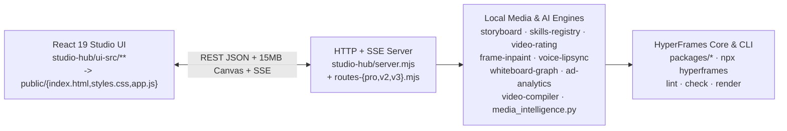

# Studio Hub Pro (V4) — Cross-Device Setup, Architecture & Git Continuation Guide

Welcome to **HyperFrames Director Studio Pro (Studio Hub V4)** — a 100% local-first, `$0`-subscription-guarded AI video production studio built on top of the open-source [HyperFrames](https://github.com/heygen-com/hyperframes) rendering engine.

Clone this repository onto **any Windows, macOS, or Linux machine** and be up and running at `http://localhost:4400` in 3 commands.

---

## 1. 3-Command Clone & Launch Guide

### Windows (PowerShell / Command Prompt)

```powershell
# 1. Clone the repository and enter the workspace
git clone https://github.com/KamrulIslamArnob/Kia.git Kia
cd Kia

# 2. Install workspace packages, build HyperFrames core, and run Studio Hub setup
bun install && bun run build && node studio-hub/setup.mjs

# 3. Launch Studio Hub on http://localhost:4400 (or double-click Start-Video-Studio.bat)
.\Start-Video-Studio.bat
```

### macOS & Linux (zsh / bash)

```bash
# 1. Clone the repository and enter the workspace
git clone https://github.com/KamrulIslamArnob/Kia.git Kia
cd Kia

# 2. Install workspace packages, build HyperFrames core, and run Studio Hub setup
bun install && bun run build && node studio-hub/setup.mjs

# 3. Launch Studio Hub on http://localhost:4400
./start-studio.sh
# (or directly via Node: node studio-hub/server.mjs)
```

> **Custom Port**: Set `STUDIO_HUB_PORT=4500 node studio-hub/server.mjs` if port `4400` is already in use.

---

## 2. System Prerequisites (Windows, macOS & Linux)

`node studio-hub/setup.mjs` automatically checks all required local tools, scaffolds `DROP_HERE/` and `projects/`, and builds the offline React 19 UI bundle (`studio-hub/public/app.js`).

| Requirement          | Minimum Version         | Purpose                                                                                                                                        |
| :------------------- | :---------------------- | :--------------------------------------------------------------------------------------------------------------------------------------------- |
| **Node.js**          | `>= 22.0`               | Runs `studio-hub/server.mjs`, native `node:test` suites, and HyperFrames CLI                                                                   |
| **Bun**              | `>= 1.1`                | Workspace package manager (`bun install`, `bun run build` — **never** use `pnpm`)                                                              |
| **FFmpeg & FFprobe** | `>= 6.0`                | Media probing, silence trimming, speed-ramping, audio ducking/mastering, H.264 MP4 encoding                                                    |
| **Python**           | `>= 3.10` (`3.10–3.14`) | Local OpenCV scene/face intelligence, `rea-video` shot/animation decomposition, Pillow brand palettes, PyMuPDF PDF parsing, Edge-TTS & Whisper |
| **Headless Chrome**  | Installed via CLI       | Deterministic 1080p/4K HTML-to-PNG design plates and HyperFrames frame capture                                                                 |

### One-Line OS Dependency Installers

#### Windows (`winget` + `pip`)

```powershell
winget install OpenJS.NodeJS.LTS Oven-sh.Bun Gyan.FFmpeg Python.Python.3.12
pip install opencv-python pillow pymupdf edge-tts faster-whisper yt-dlp PyYAML videomd
pip install --no-deps git+https://github.com/JuneYaooo/rea-video.git
npx hyperframes browser ensure
```

#### macOS (`Homebrew` + `pip3`)

```bash
brew install node bun ffmpeg python
pip3 install opencv-python pillow pymupdf edge-tts faster-whisper yt-dlp PyYAML videomd
pip3 install --no-deps git+https://github.com/JuneYaooo/rea-video.git
npx hyperframes browser ensure
```

#### Linux — Ubuntu / Debian (`apt` + `pip3`)

```bash
curl -fsSL https://bun.sh/install | bash
sudo apt update && sudo apt install -y nodejs ffmpeg python3 python3-pip
pip3 install opencv-python pillow pymupdf edge-tts faster-whisper yt-dlp PyYAML videomd
pip3 install --no-deps git+https://github.com/JuneYaooo/rea-video.git
npx hyperframes browser ensure
```

> **Offline Whisper Note**: `media_intelligence.py` runs `faster-whisper` with `local_files_only=True` first so offline machines never hang downloading multi-GB weights. To pre-cache weights once while online, run:
> `python -c "from faster_whisper import WhisperModel; WhisperModel('base')"`

---

## 3. Complete Studio Hub Module & Architecture Map



### 3.1 Backend Engines (`studio-hub/`)

| File                                  | Responsibility                                                                                                                                                                                                    |
| :------------------------------------ | :---------------------------------------------------------------------------------------------------------------------------------------------------------------------------------------------------------------- |
| `studio-hub/setup.mjs`                | Cross-OS environment doctor, `DROP_HERE/` + `projects/` scaffolder, and React 19 UI build bootstrapper.                                                                                                           |
| `studio-hub/server.mjs`               | Zero-dependency HTTP/1.1 + Range media streaming (`/media/:slug/*`) + SSE server (`http://localhost:4400`), mounting `routes-v3`, `routes-v2`, `routes-pro`, and 20 core project routes.                          |
| `studio-hub/lib.mjs`                  | Cross-platform path/binary discovery (`getToolEnv`, `resolvePythonBin`, `findChromeHeadlessShell`), FFprobe cache, `DROP_HERE` auto-ingest, `PROJECT_BRIEF.json` & `AI_READY_PROMPT.md` sync.                     |
| `studio-hub/media_intelligence.py`    | Python CLI (`analyze-raw`, `analyze-inspiration`, `extract-brand`, `transcribe`) using OpenCV, Pillow, PyMuPDF, and offline-safe `faster-whisper`.                                                                |
| `studio-hub/rea-inspiration.mjs`      | Deep inspiration video decomposition via [`JuneYaooo/rea-video`](https://github.com/JuneYaooo/rea-video) (`decomposeInspirationWithReaVideo`, `applyInspirationStyleToStoryboard`, `VIDEO.md`, `storyboard.jpg`). |
| `studio-hub/folder-ingest.mjs`        | Non-destructive external folder scanner (`scanExternalFolder`, `importExternalFolder`) and `runMediaIntelligence` bridge.                                                                                         |
| `studio-hub/storyboard.mjs`           | 6 layout archetypes, 8 motion presets, natural-language `parseFramePrompt`, versioned `STORYBOARD.json`, and 1080p Clean + Animation Blueprint HUD PNG renderer via Headless Chrome.                              |
| `studio-hub/skills-registry.mjs`      | Dynamic local `SKILL.md` discovery across 4 scopes (`.agents/skills`, `skills/`, `projects/<slug>/skills`, `~/.gemini/config/skills`), 3-mode local installer, and `compileSkillDirectives`.                      |
| `studio-hub/video-rating.mjs`         | Pre-render Whole-Video Quality Scorer (`0–100`, `S`..`C` grade, 6 weighted categories incl. real WCAG 2.1 luminance contrast & active skill compliance) + 1-click `suggestedFixPrompt`s.                          |
| `studio-hub/frame-inpaint.mjs`        | Draw-on-Frame stroke/zone analyzer (`brush`, `box`, `arrow`, `pin`), base64 PNG mask persistence, surgical regional frame regeneration (`v1 -> v2`), and Saved Frames Vault.                                      |
| `studio-hub/voice-lipsync.mjs`        | 10-voice `Bengali`/`English`/`Hindi` `VOICE_CATALOG`, original video voice extraction + `silencedetect` auto-sync, OpenCV face/mouth detection, 30fps `visemeEnvelope`, and `setpts` lip-sync alignment.          |
| `studio-hub/whiteboard-graph.mjs`     | Node-based `footage` + `note` -> `scene` graph persistence (`.studio/whiteboard.json`), dead-air trimming, FFmpeg `concat`/`xfade` 1080p 30fps stitching, and storyboard frame compilation.                       |
| `studio-hub/ad-analytics.mjs`         | Pre-publish Ad Creative & Retention Analytics (`thumbstopHookScore`, second-by-second `retentionCurve`, `dropOffRisks`, `soundOffScore`, TikTok/Reels/Shorts safe zones, 3 A/B `hookVariants`).                   |
| `studio-hub/video-compiler.mjs`       | 5-stage master compiler: (1) clip slicing & speed-ramping, (2) neural VO + synthesized SFX + ducked BGM mastering, (3) GSAP scene HTML generation, (4) `hyperframes lint` & `check`, (5) MP4 render.              |
| `studio-hub/captions-engine.mjs`      | Word-level caption timing alignment (`alignScriptToWordTimings`) and kinetic/editorial HyperFrames `<template>` sub-compositions.                                                                                 |
| `studio-hub/sound-engine.mjs`         | Procedural WAV SFX synthesizer (`12` cinema/UI SFX presets), audio transient beat detector (`detectAudioBeats`), and ducked BGM mixer.                                                                            |
| `studio-hub/color-grade.mjs`          | `10` cinema FFmpeg color looks (`kodak-2383-warm`, `emerald-vibrant`, `apple-keynote-crisp`, etc.) and frame/clip LUT grading.                                                                                    |
| `studio-hub/presets/camera-rigs.mjs`  | Director-of-Photography camera bodies, prime focal lengths (`14mm`–`85mm`), aperture stops, and `24` GSAP camera motion presets.                                                                                  |
| `studio-hub/templates/pack-*.mjs`     | 6 modular HyperFrames HTML+GSAP scene archetype packs (`device-spotlight`, `editorial-bento`, `cinema-statement`, `wipe-metrics`, `behind-speaker`, `social-hooks`).                                              |
| `studio-hub/beat-quantizer.mjs`       | Music BPM/transient beat grid snap (`quantizeStoryboardToBeats`) aligning scene cuts (`0`–`4` frames) & kinetic text staggers to BGM/VO transients.                                                               |
| `studio-hub/subject-matte.mjs`        | Local OpenCV GrabCut + skin-chrominance matte extractor (`extractSubjectForegroundMatte`) generating RGBA `*_matte.png` foreground plates for Depth-of-Text behind-speaker typography.                            |
| `studio-hub/smart-reframe.mjs`        | Face/focal-aware multi-aspect crop planner (`computeSmartReframePlan` across `9:16`, `1:1`, `4:5`, `16:9`) + FFmpeg `crop+scale` filter generator.                                                                |
| `studio-hub/delta-cache.mjs`          | SHA-256 per-scene content-addressable render cache (`computeSceneContentHash`, `.studio/scene-cache/index.json`) so unchanged scenes reuse rendered clips in `<2s`.                                               |
| `studio-hub/skill-bundles.mjs`        | Portable `.studioskills.json` preset pack exporter/importer (`exportSkillBundle`, `importSkillBundle`) bundling `SKILL.md` + `references/*.md` with SHA-256 checksums.                                            |
| `studio-hub/subtitle-exporter.mjs`    | Broadcast-valid UTF-8 `.srt`, `.vtt`, and styled `.ass` subtitle sidecar exporter (`writeProjectSubtitles`, `exportSubtitles`).                                                                                   |
| `studio-hub/thumbnail-ab-gen.mjs`     | High-CTR 3-variant A/B/C YouTube/Reels cover generator (`generateThumbnailAbVariants`: `curiosity-hook`, `value-split`, `detail-magnifier`) rendered via Headless Chrome.                                         |
| `studio-hub/local-batch-runner.mjs`   | Multi-language (`Bengali`, `English`, `Hindi`) localized variant builder (`buildLocalizedAdVariantsPlan`) writing ready-to-render storyboards in `.studio/variants/`.                                             |
| `studio-hub/google-flow-playbook.mjs` | `$0` subscription Google Images & Google Flow (`labs.google/fx/tools/flow`) batch shot manifest builder.                                                                                                          |
| `studio-hub/agent-bridge.mjs`         | 6-Agent crew state, `$0` `zeroCostGuard` enforcement, persistent `.studio/agent-queue/tickets.json`, CLI (`--list-pending`, `--claim`, `--complete`), and SSE broadcaster.                                        |
| `studio-hub/routes-pro.mjs`           | Pro catalog & specialist endpoints (`/api/catalog/presets`, `preview-sfx`, `color-grade`, `captions/generate`, `google-multimodal-plan`).                                                                         |
| `studio-hub/routes-v2.mjs`            | V2 endpoints (`/api/skills`, `/api/skills/install`, `/api/projects/:slug/{skills,rating,saved-frames}`, `15MB` `regenerate-region`).                                                                              |
| `studio-hub/routes-v3.mjs`            | V3 endpoints (`/api/voices`, `/api/pm-insights`, `/api/projects/:slug/{voice-sync,whiteboard,whiteboard/compile-scene,ad-analytics,inspiration/rea-decompose,inspiration/apply-to-storyboard}`).                  |
| `studio-hub/routes-v4.mjs`            | V4 power-tools endpoints (`/api/projects/:slug/{beat-quantize,subject-matte,smart-reframe,subtitles-export,thumbnails-generate,localized-variants}`, `/api/skill-bundles/{export,import}`).                       |

### 3.2 Offline Local React 19 Studio (`studio-hub/ui-src/` + `build-ui.mjs`)

- **Bundler**: `node studio-hub/build-ui.mjs` bundles `studio-hub/ui-src/main.jsx` with local React `19.2.6` + `esbuild` into `studio-hub/public/{index.html, styles.css, app.js}` (`100%` offline, zero CDN runtime dependencies).
- **State & Design System**: White-Mode minimalist UI (`ui-src/styles/studio.css`, `ui-src/store.jsx`, `ui-src/api.js`) with URL-synced 5-step backable navigation (`#step-1`..`#step-5`), zero emojis, concentric `16px / 8px / 8px` cards, and live SSE updates:
  - `Sidebar.jsx`, `App.jsx`, `AgentsDrawer.jsx`
  - `StepsOneToThree.jsx` (`StepOneRaw` + Whiteboard mode tab, `StepTwoInspiration` + `rea-video` deep animation/style breakdown & 1-click storyboard style transfer, `StepThreeBrand` + `VoiceAndLipSyncCard` + `SkillsAndRatingPanel`)
  - `StepFourStoryboard.jsx` (1080p Clean/HUD grid + `WhiteboardCanvas` tab + `ProToolsBelt` (`mode="storyboard"`) + `SkillsAndRatingPanel` + `AdAnalyticsPanel` + `FrameCanvasEditor` + `SavedFramesDrawer`)
  - `StepFiveExport.jsx` (5-stage compiler checklist with Delta Scene Cache, `ProToolsBelt` (`mode="export"`), Master `<video>` player, `AdAnalyticsPanel`)

### 3.3 Multi-Agent Crew & Architecture Specs

- **Agent Skills**: `.agents/skills/director-studio-pro/SKILL.md` & `.agents/skills/rea-video/SKILL.md`
- **Workflow Scripts**: `studio-hub/workflows/director_crew.py` & `studio-hub/workflows/google_media_crew.py`
- **Detailed Design & API Specs**:
  - `studio-hub/README.md` — Developer & REST API Reference
  - `studio-hub/docs/PRODUCT_SPEC_V2.md` — Product & UX Specification
  - `studio-hub/docs/ARCHITECTURE_CONTRACTS.md` — V2 TypeScript/JSDoc & REST Contracts
  - `studio-hub/docs/V3_CONTRACTS.md` — V3/V4 Voice, Whiteboard, Ad Analytics, `rea-video` & Power-Tools Contracts
  - `studio-hub/docs/PM_CONTINUOUS_RESEARCH.md`, `studio-hub/docs/PM_ROADMAP_V4.md` & `studio-hub/docs/pm-insights.json`

---

## 4. Verification, Linting & 35-File Test Suite

Run these commands after pulling updates or making changes on any device:

```bash
# 1. Rebuild the React 19 UI bundle after editing studio-hub/ui-src/**
node studio-hub/build-ui.mjs

# 2. Run all 35 Studio Hub automated test suites (unit + HTTP + FFmpeg + rea-video + V4 power-tools + Headless Chromium E2E)
node --test studio-hub/tests/*.test.mjs

# 3. Lint and check formatting (uses oxlint & oxfmt — never eslint/prettier)
./node_modules/.bin/oxlint studio-hub/*.mjs studio-hub/presets studio-hub/templates studio-hub/tests studio-hub/ui-src
./node_modules/.bin/oxfmt --check studio-hub/

# 4. Run core HyperFrames monorepo tests if you edited packages/*
bun run build && bun run test
```

---

## 5. Git Remotes, Upstream Sync & Feature Branch Workflow

This repository layers **Studio Hub Pro (`studio-hub/`, `.agents/skills/{director-studio-pro,rea-video}/`, `STUDIO_SETUP.md`)** cleanly on top of the open-source **HyperFrames** monorepo (`heygen-com/hyperframes`) without breaking core packages.

### 5.1 Recommended Remote Setup (On Any New Device)

Configure `origin` as **your personal GitHub repository** and `upstream` as **`heygen-com/hyperframes`**:

```bash
# Inspect current remotes
git remote -v

# If cloning from your personal GitHub fork/repo, add upstream once:
git remote add upstream https://github.com/heygen-com/hyperframes.git

# Or if you originally cloned heygen-com/hyperframes as origin, repoint remotes cleanly:
git remote rename origin upstream
git remote add origin https://github.com/KamrulIslamArnob/Kia.git
git push -u origin main
```

### 5.2 Pulling Latest Upstream HyperFrames Updates into `main`

```bash
git checkout main
git fetch upstream

# Merge upstream/main cleanly into your main branch
git merge upstream/main

# Rebuild core packages & Studio UI, then verify gates
bun install
bun run build
node studio-hub/build-ui.mjs
node --test studio-hub/tests/*.test.mjs

# Push updated main to your GitHub repo
git push origin main
```

### 5.3 Developing New Features & Merging into `main`

1. **Branch from `main`**:
   ```bash
   git checkout main
   git pull origin main
   git checkout -b feat/my-studio-feature
   ```
2. **Develop with TDD & Formatting**:
   - Add/update tests in `studio-hub/tests/<feature>.test.mjs`.
   - Rebuild UI if `studio-hub/ui-src/` changed: `node studio-hub/build-ui.mjs`.
   - Format & lint before committing:
     ```bash
     npx oxfmt studio-hub/
     npx oxlint studio-hub/*.mjs studio-hub/presets studio-hub/templates studio-hub/tests studio-hub/ui-src
     node --test studio-hub/tests/*.test.mjs
     ```
3. **Commit with Conventional Commits & Merge Cleanly to `main`**:
   ```bash
   git add -A
   git commit -m "feat(studio-hub): describe your improvement"
   git checkout main
   git merge --no-ff feat/my-studio-feature
   git push origin main
   git branch -d feat/my-studio-feature
   ```

> **What Stays Local (Git-Ignored by Design)**:
> Heavy user media and machine-specific state (`projects/**`, root `*.mp4` / `*.mov`, `DROP_HERE/*/*`, `studio-hub/.provider-settings.json`, `.hyperframes/`) are excluded via `.gitignore` so `git push origin main` stays fast, clean, and well under GitHub's file size limits on every device.
