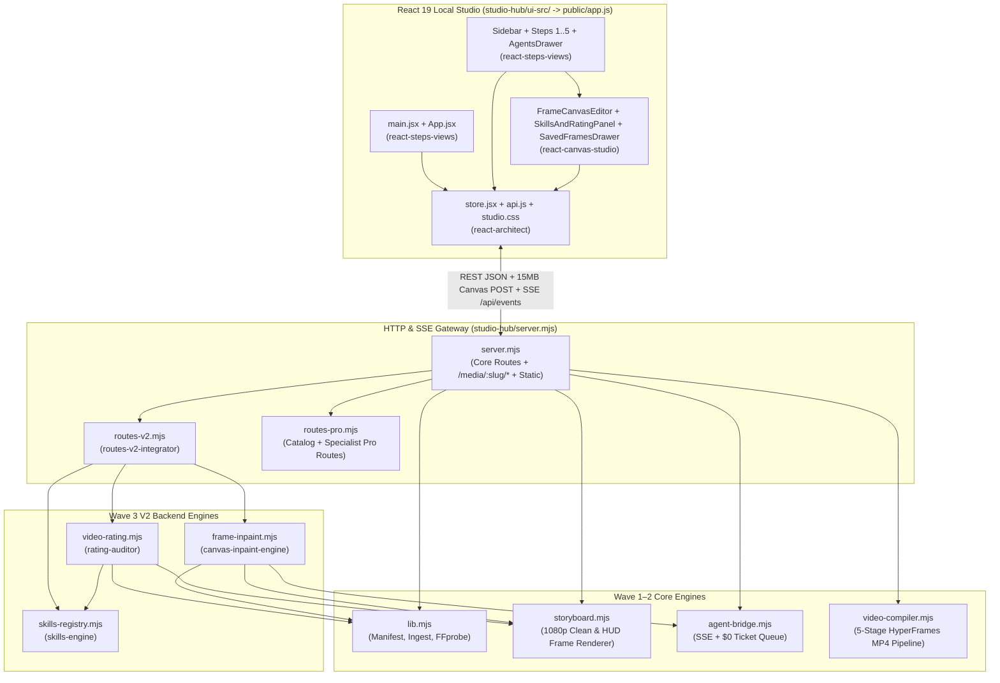

# Studio Hub V2 — Cross-Pod Architecture & API Contracts

> **Owner**: `tech-pm`  
> **Scope**: Authoritative TypeScript/JSDoc interfaces, module export signatures, filesystem persistence schemas, SSE envelopes, and HTTP REST JSON contracts across Wave 1–2 foundations (`lib.mjs`, `storyboard.mjs`, `agent-bridge.mjs`, `routes-pro.mjs`, `server.mjs`) and all 7 Wave 3 V2 pods (`skills-engine`, `rating-auditor`, `canvas-inpaint-engine`, `routes-v2-integrator`, `react-architect`, `react-canvas-studio`, `react-steps-views`), gated by `v2-chief-qa`.

---

## 1. System Topology & Pod Ownership Matrix



### Wave 3 Pod Ownership

| Pod | Owned Files | Consumers |
| :--- | :--- | :--- |
| **`skills-engine`** | `studio-hub/skills-registry.mjs`, `studio-hub/tests/skills-registry.test.mjs` | `routes-v2.mjs`, `video-rating.mjs`, `server.mjs` (`storyboard/generate`) |
| **`rating-auditor`** | `studio-hub/video-rating.mjs`, `studio-hub/tests/video-rating.test.mjs` | `routes-v2.mjs`, `store.jsx`, `SkillsAndRatingPanel.jsx`, `StepFourStoryboard.jsx` |
| **`canvas-inpaint-engine`** | `studio-hub/frame-inpaint.mjs`, `studio-hub/tests/frame-inpaint.test.mjs` | `routes-v2.mjs`, `store.jsx`, `FrameCanvasEditor.jsx`, `SavedFramesDrawer.jsx` |
| **`routes-v2-integrator`** | `studio-hub/routes-v2.mjs`, `studio-hub/tests/routes-v2.test.mjs` | `server.mjs`, `ui-src/store.jsx` |
| **`react-architect`** | `studio-hub/build-ui.mjs`, `studio-hub/ui-src/{api.js,store.jsx}`, `studio-hub/ui-src/styles/studio.css` | `react-canvas-studio`, `react-steps-views`, `v2-chief-qa` |
| **`react-canvas-studio`** | `studio-hub/ui-src/components/{FrameCanvasEditor,SkillsAndRatingPanel,SavedFramesDrawer}.jsx` | `StepThreeBrand.jsx`, `StepFourStoryboard.jsx`, `App.jsx` |
| **`react-steps-views`** | `studio-hub/ui-src/components/{Sidebar,StepsOneToThree,StepFourStoryboard,StepFiveExport,AgentsDrawer}.jsx`, `studio-hub/ui-src/{App,main}.jsx` | `build-ui.mjs` -> `studio-hub/public/{app.js,styles.css,index.html}` |
| **`v2-chief-qa`** | Final integration in `server.mjs` + `node studio-hub/build-ui.mjs` + full E2E release gate | User / Production |

---

## 2. Core Foundation Contracts & Invariants (`lib.mjs`, `storyboard.mjs`, `server.mjs`, `agent-bridge.mjs`)

### 2.1 `studio-hub/lib.mjs` — Project Manifest & Path Confinement

```ts
export const ROOT_DIR: string;
export const PROJECTS_DIR: string; // <repo>/projects
export const DROP_DIR: string;     // <repo>/DROP_HERE
export const CATEGORIES: readonly ["raw-video", "inspiration", "references", "images", "brand", "audio"];

export function assertValidSlug(slug: string): string; // Returns absolute projectDir or throws Error("Invalid project slug..." | "Unsafe project path...")
export function ensureProjectDirs(slug: string): string; // Creates inbox/*, assets/*, .studio/frames/{raw,inspiration,design,tmp}, .studio/agent-queue
export function sanitizeSlug(raw: string): string;
export function sanitizeFilename(raw: string): string;
export function findChromeHeadlessShell(baseDir?: string): string | null;
export function getToolEnv(): NodeJS.ProcessEnv;
export function runCommand(cmd: string, args: string[], options?: { cwd?: string; env?: Record<string, string>; shell?: boolean; onOutput?: (chunk: string) => void }): Promise<{ code: number; stdout: string; stderr: string }>;
export function syncProjectManifest(slug: string, briefPatch?: Partial<ProjectBrief> | null): Promise<ProjectBrief>;
```

> **CRITICAL INVARIANT — `syncProjectManifest` Fixed-Key Rewrite**:
> In `studio-hub/lib.mjs` (lines 771–808), `syncProjectManifest(slug, briefPatch)` constructs a fresh `manifest` object with fixed top-level keys (`slug`, `title`, `aspectRatio`, `width`, `height`, `fps`, `durationSeconds`, `language`, `brandColors`, `brandKit`, `inspirationProfile`, `sourceFolders`, `instructions`, `referenceLinks`, `hasIndexHtml`, `files`, `updatedAt`) and rewrites **both** `PROJECT_BRIEF.json` and `AI_READY_PROMPT.md`.
> - **Rule for `skills-registry.mjs`**: When `setSelectedProjectSkills(slug, skillIds)` writes `selectedSkills` to `PROJECT_BRIEF.json` and appends `## Active Dynamic Skills` to `AI_READY_PROMPT.md`, it **MUST ALSO** persist a sidecar file in `projects/<slug>/.studio/` (e.g., `projects/<slug>/.studio/selected-skills.json`) and have `getSelectedProjectSkills(slug)` fall back to that sidecar whenever `syncProjectManifest(slug)` has refreshed `PROJECT_BRIEF.json`.

#### `ProjectBrief` (`projects/<slug>/PROJECT_BRIEF.json`)

```ts
export interface BrandColors {
  primary: string;    // e.g. "#1E824C"
  secondary: string;  // e.g. "#2ECC71"
  accent: string;     // e.g. "#F1C40F"
  background: string; // e.g. "#0A1612"
}

export interface BrandKit {
  logoRelPath: string | null;
  guidelinesText: string;
  fonts: { heading: string; body: string };
  tone: string;
  extractedPalette: string[];
}

export interface InspirationProfile {
  duration?: number;
  width?: number;
  height?: number;
  cutCount?: number;
  avgShotLength: number;
  cutsPerMinute: number;
  pacing: "fast-kinetic" | "rhythmic-editorial" | "calm-cinematic";
  brightness: number;
  contrast: number;
  dominantColors: string[];
  styleFrames: string[];     // project-relative POSIX paths
  styleFrameUrls?: string[]; // /media/:slug/... URLs
  videoRelPath?: string;
  videoUrl?: string;
  analyzedAt?: string;
}

export interface ProjectBrief {
  slug: string;
  title: string;
  aspectRatio: "9:16" | "16:9" | "1:1" | "4:5";
  width: number;
  height: number;
  fps: number;
  durationSeconds: number;
  language: string;
  brandColors: BrandColors;
  brandKit: BrandKit;
  inspirationProfile: InspirationProfile | null;
  sourceFolders: string[];
  instructions: string;
  referenceLinks: Array<{ id: string; url: string; title: string; notes: string; addedAt: string }>;
  selectedSkills?: string[]; // Persisted by skills-registry.mjs (+ .studio/ sidecar)
  hasIndexHtml: boolean;
  files: {
    rawVideo: MediaFileEntry[];
    inspiration: MediaFileEntry[];
    references: MediaFileEntry[];
    images: MediaFileEntry[];
    brand: MediaFileEntry[];
    audio: MediaFileEntry[];
    clips: MediaFileEntry[];
    assetImages: MediaFileEntry[];
    assetAudio: MediaFileEntry[];
    renders: MediaFileEntry[];
  };
  updatedAt: string;
}
```

---

### 2.2 `studio-hub/storyboard.mjs` — Storyboard & 1080p Hero/HUD Frame Schema

```ts
export const LAYOUT_ARCHETYPES: readonly [
  "device-3d-showcase",
  "split-editorial",
  "fullbleed-cinema",
  "bento-feature-grid",
  "spotlight-cursor-zoom",
  "kinetic-statement-card",
];

// Dual-indexed array + lookup map (MOTION_PRESETS[0] and MOTION_PRESETS["crash-zoom-in"] both work)
export const MOTION_PRESETS: ReadonlyArray<MotionPresetSpec> & Record<string, MotionPresetSpec>;

export interface CameraMotion {
  presetId: string;
  label: string;
  fromScale: number;     // e.g. 1.0
  toScale: number;       // e.g. 1.85
  panX: number;          // percentage offset (-35..35)
  panY: number;          // percentage offset (-35..35)
  tiltDeg: number;       // -35..35
  focusX: number;        // 0..100 (percentage of frame width!)
  focusY: number;        // 0..100 (percentage of frame height!)
  ease: string;          // e.g. "expo.out"
  transitionIn: string;  // e.g. "zoom-through" | "rack-focus" | "waterfall-cut" | "cut-the-curve" | "inverse-zoom" | "whip-pan"
  transitionOut: string;
}

export interface FrameStaging {
  headline: string;
  subheadline: string;
  badgeText: string;
  captionText: string;
  ctaText: string;
  theme: "brand-dark" | "light" | "dark" | "gold" | "emerald" | "warm";
  calloutItems: Array<{ label: string; value: string; side?: "left" | "right" }>;
  calloutCard?: { side: "left" | "right"; label?: string; text: string; accentColor?: string } | null;
  cursorTarget: { x: number; y: number; showRipple?: boolean }; // x, y in 0..100 percentage!
  regionHighlight?: {
    zone: string;
    x: number;
    y: number;
    width: number;
    height: number;
    label?: string;
    accentColor?: string;
  } | null;
}

export interface FrameAudioSpec {
  voiceoverText: string;
  voiceoverSrc: string | null;
  sfx: string[];
  bgmMood: string;
}

export interface StoryboardFrame {
  id: string;              // e.g. "frame_01"
  index: number;           // 1-based
  sceneId: string;         // e.g. "scene_01"
  title: string;
  narrativeBeat: string;
  layout: string;
  motionPreset: string;
  cameraMotion: CameraMotion;
  durationSeconds: number;
  speedFactor: number;     // 0.25..4
  sourceClip: string | null;
  rawTimeRange: [number, number];
  keyframes: { start: string | null; peak: string | null; end: string | null };
  aiBackgroundPlate: string | null;
  aiVideoClip: string | null;
  staging: FrameStaging;
  audioSpec: FrameAudioSpec;
  locked: boolean;
  approved: boolean;
  prompt: string;
  currentVersion: number;  // 1, 2, 3...
  designFramePath: string; // ".studio/frames/design/frame_01_v1.png"
  hudFramePath: string;    // ".studio/frames/design/frame_01_v1_hud.png"
  designFrameUrl: string;  // "/media/<slug>/.studio/frames/design/frame_01_v1.png"
  hudFrameUrl: string;     // "/media/<slug>/.studio/frames/design/frame_01_v1_hud.png"
  // Decorated by server.mjs / routes-v2.mjs for UI consumption:
  currentDesignImage?: string;
  currentBlueprintImage?: string;
  rawKeyframes?: { start: string | null; peak: string | null; end: string | null } | string[];
  history: VersionSnapshot[];
}

export interface Storyboard {
  schemaVersion: number;
  slug: string;
  title: string;
  aspectRatio: string;
  width: number;
  height: number;
  fps: number;
  globalPrompt: string;
  brandColors: BrandColors;
  inspirationProfile: InspirationProfile | null;
  frameCount: number;
  lockedCount: number;
  approvedCount: number;
  totalDurationSeconds: number;
  createdAt: string;
  updatedAt: string;
  frames: StoryboardFrame[];
}
```

#### Exported Functions in `storyboard.mjs`

```ts
export function loadStoryboard(slug: string): Storyboard | null;
export function saveStoryboard(slug: string, storyboard: Partial<Storyboard>): Storyboard;
export function generateStoryboard(opts: {
  slug: string;
  projectBrief?: ProjectBrief | null;
  rawAnalysis?: Record<string, unknown> | null;
  inspirationProfile?: InspirationProfile | null;
  globalPrompt?: string;
  targetScenes?: number;
  preserveLocked?: boolean;
}): Promise<Storyboard>;
export function regenerateFrame(opts: {
  slug: string;
  frameId: string;
  prompt?: string;
  motionPreset?: string | null;
  layout?: string | null;
  overrides?: Partial<StoryboardFrame> & {
    cameraMotion?: Partial<CameraMotion>;
    staging?: Partial<FrameStaging>;
    audioSpec?: Partial<FrameAudioSpec>;
  };
}): Promise<{ frame: StoryboardFrame; storyboard: Storyboard }>;
export function updateFrame(opts: {
  slug: string;
  frameId: string;
  patch: Partial<StoryboardFrame> & { revertToVersion?: number };
}): Promise<{ frame: StoryboardFrame; storyboard: Storyboard }>;
```

> **Coordinate Unit Alignment Rule (`0..1` Normalized vs `0..100` Percentage)**:
> - `frame-inpaint.mjs` `analyzeAnnotationRegion` computes normalized `0..1` coordinates (`x, y, width, height, centerX, centerY`).
> - `storyboard.mjs` `cameraMotion.focusX`, `cameraMotion.focusY`, and `staging.cursorTarget.{x, y}` use **`0..100` percentage units** (e.g. `focusX: Math.round(centerX * 100)`).
> - `frame-inpaint.mjs` MUST convert `0..1` normalized coordinates to `0..100` (`centerX * 100`, `centerY * 100`) when writing into `overrides.cameraMotion.{focusX, focusY}` or `overrides.staging.cursorTarget.{x, y}`!

---

### 2.3 `studio-hub/agent-bridge.mjs` — `$0` Guard, Tickets & SSE

```ts
export const VALID_TASK_TYPES: readonly [
  "ai_storyboard_direct",
  "ai_regenerate_frame",
  "ai_generate_image_plate",
  "ai_google_flow_video",
  "ai_full_video_edit",
];

export function enqueueAgentTask(opts: {
  slug: string;
  type: (typeof VALID_TASK_TYPES)[number];
  payload?: Record<string, unknown>;
}): AgentTicket;

export function broadcastEvent(type: string, payload?: Record<string, unknown>): {
  type: string;
  payload: Record<string, unknown>;
  timestamp: string;
  deliveredCount: number;
};
```

---

## 3. Pod 1 Contract — `skills-engine` (`studio-hub/skills-registry.mjs`)

### TypeScript / JSDoc Interfaces

```ts
export type SkillSourceScope =
  | "workspace-agents"   // .agents/skills/*/SKILL.md (installed: true)
  | "workspace-skills"   // skills/*/SKILL.md (installed: true)
  | "project"            // projects/<slug>/skills/*/SKILL.md (installed: true)
  | "global-available";  // ~/.gemini/config/skills/*/SKILL.md (installed: true if mirrored locally, else false)

export type SkillCategory = "motion" | "captions" | "design" | "video" | "brand" | "general";

export interface SkillDescriptor {
  id: string;                    // Directory slug, e.g. "motion-doctrine", "seam-craft", "captions-overlay"
  name: string;                  // YAML frontmatter `name` or directory name
  description: string;           // YAML frontmatter `description`
  category: SkillCategory;
  sourceScope: SkillSourceScope;
  installed: boolean;
  skillDir: string;              // Absolute directory path on disk
  skillMdPath?: string;          // Absolute path to SKILL.md
  ruleHighlights: string[];      // Top <= 5 concrete rules/metrics parsed from Markdown body
  extractedHexColors: string[];  // Hex codes (#RRGGBB) parsed from SKILL.md
  motionKeywords: string[];      // Extracted motion/transition keywords
}

export interface InstallSkillInput {
  sourcePath?: string | null;    // Mode 1: Copy full skill folder from local disk path
  globalSkillId?: string | null; // Mode 2: Copy from ~/.gemini/config/skills/<globalSkillId>
  name?: string | null;          // Mode 3: Author custom local SKILL.md
  description?: string | null;   // Optional description for custom local SKILL.md
  content?: string | null;       // Markdown body (or full frontmatter + body) for Mode 3
  targetScope?: "workspace" | "project"; // Defaults to "workspace" (.agents/skills/<id>/)
  slug?: string | null;          // Required when targetScope === "project"
}

export interface StagingHints {
  preferMinimalPalette: boolean;
  enforceCaptionOverlay: boolean;
  includeOversizedCursor: boolean;
  enforceSeamCraft: boolean;
  preferredArchetypes: string[];
  contrastFloor: number;         // e.g. 4.5 (WCAG AA) or 7.0 (AAA)
}

export interface SkillRatingCheck {
  skillId: string;
  skillName: string;
  checkId: string;
  description: string;
  ruleType: string;
}

export interface CompiledSkillDirectives {
  activeSkills: SkillDescriptor[];
  promptInjection: string;
  stagingHints: StagingHints;
  ratingChecks: SkillRatingCheck[];
}
```

### Required Module Exports (`studio-hub/skills-registry.mjs`)

```ts
export function discoverLocalSkills(opts?: { slug?: string | null }): Promise<SkillDescriptor[]> | SkillDescriptor[];
export function installSkillToLocal(opts: InstallSkillInput): Promise<SkillDescriptor> | SkillDescriptor;
export function getSelectedProjectSkills(slug: string): Promise<string[]> | string[];
export function setSelectedProjectSkills(slug: string, skillIds: string[]): Promise<string[]> | string[];
export function compileSkillDirectives(opts: { slug?: string | null; skillIds?: string[] }): Promise<CompiledSkillDirectives> | CompiledSkillDirectives;
```

### Cross-Pod Alignment Rules
1. **Sync/Async Safety**: Consumers (`routes-v2.mjs`, `video-rating.mjs`, `server.mjs`) MUST `await` every `skills-registry.mjs` call (`await` handles both synchronous and Promise return values transparently).
2. **`installSkillToLocal` Return Shape**: Returns a `SkillDescriptor` (with `installed: true`). In `routes-v2.mjs`, normalize via `const raw = await installSkillToLocal(body); const installedSkill = raw?.installedSkill || raw?.skill || raw;` and then re-run `const skills = await discoverLocalSkills({ slug: body.slug || null });` so `POST /api/skills/install` always returns `{ ok: true, installedSkill, skills }`.
3. **Persistence Durability**: `setSelectedProjectSkills(slug, skillIds)` writes `selectedSkills` to `projects/<slug>/PROJECT_BRIEF.json`, appends/updates `## Active Dynamic Skills` in `projects/<slug>/AI_READY_PROMPT.md`, and persists `projects/<slug>/.studio/selected-skills.json` so `syncProjectManifest(slug)` never wipes `selectedSkills`.

---

## 4. Pod 2 Contract — `rating-auditor` (`studio-hub/video-rating.mjs`)

### TypeScript / JSDoc Interfaces

```ts
export type RatingGrade = "S" | "A+" | "A" | "B+" | "B" | "C";

export interface CategoryScoreDetail {
  score: number;   // 0..100 integer
  weight: number;  // e.g. 0.20 (weights across the 6 categories sum to 1.0)
  detail: string;  // Concise human diagnostic explanation
  label?: string;  // Optional UI display label
}

export interface VideoRatingCategories {
  hookAndPacing: CategoryScoreDetail;
  visualHierarchyAndContrast: CategoryScoreDetail;
  motionContinuity: CategoryScoreDetail;
  skillAlignment: CategoryScoreDetail;
  brandConsistency: CategoryScoreDetail;
  audioAndCaptions: CategoryScoreDetail;
}

export interface FrameDiagnosticRating {
  frameId: string;                   // e.g. "frame_01"
  index: number;                     // 1-based shot number
  title: string;
  score: number;                     // 0..100
  grade: RatingGrade;
  locked: boolean;
  strengths: string[];
  issues: string[];
  suggestedFixPrompt: string | null; // Executable 1-click prompt for regenerateFrame(), or null if clean
}

export interface VideoRatingReport {
  slug?: string;
  overallScore: number;              // 0..100 integer
  grade: RatingGrade;                // S (>=95), A+ (90..94), A (85..89), B+ (80..84), B (70..79), C (<70)
  verdict: string;                   // 1-sentence human readiness summary
  categories: VideoRatingCategories; // Canonical 6-category map
  subScores?: VideoRatingCategories; // Optional alias to `categories` for defensive UI compatibility
  frameRatings: FrameDiagnosticRating[];
  activeSkillIds?: string[];
  evaluatedAt: string;               // ISO-8601 timestamp
}
```

### Required Module Export (`studio-hub/video-rating.mjs`)

```ts
export function evaluateProjectVideoRating(opts: {
  slug: string;
  project?: ProjectBrief | null;
  storyboard?: Storyboard | null;
  selectedSkillSpecs?: SkillDescriptor[];
}): Promise<VideoRatingReport>;
```

- **Persistence**: Writes latest report to `projects/<slug>/.studio/latest-rating.json`.
- **UI Consumer Alignment (`SkillsAndRatingPanel.jsx` & `StepFourStoryboard.jsx`)**:
  - Read overall score via `videoRating.overallScore` and grade via `videoRating.grade`.
  - Read the 6 category bars via `const cats = videoRating.categories || videoRating.subScores || {};` using the exact 6 keys: `hookAndPacing`, `visualHierarchyAndContrast`, `motionContinuity`, `skillAlignment`, `brandConsistency`, `audioAndCaptions`, where each entry has `{ score, weight, detail }`.
  - Read per-frame issues via `videoRating.frameRatings` (`fr.frameId`, `fr.issues`, `fr.suggestedFixPrompt`).

---

## 5. Pod 3 Contract — `canvas-inpaint-engine` (`studio-hub/frame-inpaint.mjs`)

### TypeScript / JSDoc Interfaces

```ts
export type CanvasToolType = "brush" | "box" | "arrow" | "pin";

export type SemanticTargetZone =
  | "badge-header"         // centerY < 0.22
  | "caption-lower-third"  // centerY > 0.76
  | "callout-left"         // centerX < 0.36 && 0.22 <= centerY <= 0.76
  | "callout-right"        // centerX > 0.64 && 0.22 <= centerY <= 0.76
  | "center-subject"       // 0.30 <= centerX <= 0.70 && 0.22 <= centerY <= 0.76
  | "motion-trajectory";   // Drawn when an "arrow" stroke is present

export interface CanvasPoint {
  x: number; // Either pixel coordinate (0..canvasWidth) or normalized (0..1)
  y: number; // Either pixel coordinate (0..canvasHeight) or normalized (0..1)
}

export interface CanvasStroke {
  tool: CanvasToolType;
  points: CanvasPoint[];
  color?: string;
  size?: number;
  label?: string;
}

export interface RegionBox {
  x: number;
  y: number;
  width: number;
  height: number;
}

export interface RegionAnalysis {
  x: number;          // 0..1 normalized bounding box left
  y: number;          // 0..1 normalized bounding box top
  width: number;      // 0..1 normalized width
  height: number;     // 0..1 normalized height
  centerX: number;    // 0..1 normalized center X
  centerY: number;    // 0..1 normalized center Y
  zone: SemanticTargetZone;
  arrowVector?: {
    dx: number;
    dy: number;
    angleDeg: number;
    magnitude: number;
    focusX: number;   // 0..100 percentage for storyboard cameraMotion.focusX
    focusY: number;   // 0..100 percentage for storyboard cameraMotion.focusY
  } | null;
  boundingBox?: { x: number; y: number; width: number; height: number; centerX: number; centerY: number };
}

export interface SavedAnnotationResult {
  annotationId: string;
  maskRelPath: string | null;       // ".studio/frames/annotations/<frameId>_<id>_mask.png"
  compositeRelPath: string | null;  // ".studio/frames/annotations/<frameId>_<id>_annotated.png"
  regionAnalysis: RegionAnalysis;
}

export interface RegenerateRegionResult {
  frame: StoryboardFrame;
  storyboard: Storyboard;
  annotationId: string;
  maskRelPath: string | null;
  compositeRelPath: string | null;
  regionAnalysis: RegionAnalysis;
  ticket?: AgentTicket | null;      // Populated when enqueueAiInpaint === true
}

export interface SavedFrameRecord {
  id: string;                       // e.g. "saved_..." (alias `savedId` also populated for UI safety!)
  savedId: string;                  // Identical to `id` so both `item.id` and `item.savedId` work!
  slug: string;
  frameId: string;                  // Source shot ID, e.g. "frame_01"
  version: number;                  // Source frame version, e.g. 2
  label: string;                    // User/shot label
  notes: string;
  imageRelPath: string;             // ".studio/frames/saved/<savedId>.png"
  imageUrl: string;                 // "/media/<slug>/.studio/frames/saved/<savedId>.png"
  createdAt: string;                // ISO-8601 timestamp (alias `savedAt` optional)
}
```

### Required Module Exports (`studio-hub/frame-inpaint.mjs`)

```ts
export function analyzeAnnotationRegion(opts: {
  strokes?: CanvasStroke[];
  regionBox?: RegionBox | null;
  canvasWidth?: number;
  canvasHeight?: number;
}): RegionAnalysis;

export function saveFrameAnnotation(opts: {
  slug: string;
  frameId: string;
  maskDataUrl?: string | null;
  compositeDataUrl?: string | null;
  strokes?: CanvasStroke[];
  regionBox?: RegionBox | null;
  prompt?: string;
}): Promise<SavedAnnotationResult> | SavedAnnotationResult;

export function regenerateFrameRegion(opts: {
  slug: string;
  frameId: string;
  maskDataUrl?: string | null;
  compositeDataUrl?: string | null;
  strokes?: CanvasStroke[];
  regionBox?: RegionBox | null;
  prompt?: string;
  selectedSkills?: string[];
  enqueueAiInpaint?: boolean;
}): Promise<RegenerateRegionResult>;

// Supports object form `{ slug, frameId, version, label, notes }` (and positional `(slug, opts)` if overloaded):
export function saveDesignFrameBookmark(
  optsOrSlug: { slug: string; frameId: string; version?: number; label?: string; notes?: string } | string,
  maybeOpts?: { frameId: string; version?: number; label?: string; notes?: string },
): Promise<SavedFrameRecord> | SavedFrameRecord;

export function listSavedFrames(slug: string): Promise<SavedFrameRecord[]> | SavedFrameRecord[];

export function deleteSavedFrame(slug: string, savedId: string): Promise<SavedFrameRecord[]> | SavedFrameRecord[];
```

### Cross-Pod Alignment Rules
1. **`CanvasPoint` Normalization**: `FrameCanvasEditor.jsx` may emit `points: [{ x, y }]` in either `0..1` normalized coordinates OR `0..canvasWidth` / `0..canvasHeight` canvas pixel coordinates. `analyzeAnnotationRegion` MUST inspect coordinate magnitudes (`> 1.01` => divide by `canvasWidth` / `canvasHeight`, else treat as already `0..1` normalized) so both work seamlessly!
2. **`storyboard.mjs` Visible Rendering Parity (`0..1 -> 0..100` + `subheadline` + `calloutItems`)**:
   - `storyboard.mjs` expects `cameraMotion.{focusX, focusY}` and `staging.cursorTarget.{x, y}` in **`0..100` percentages** (`Math.round(centerX * 100)`).
   - `storyboard.mjs` `renderArchetypeStageHtml` renders `staging.subheadline` (sync alongside any `subline` alias) and `staging.calloutItems[0]` (`left-callout`) / `staging.calloutItems[1]` (`right-callout`) alongside `staging.calloutCard` so the re-rendered `vN+1` 1080p PNG visibly reflects `"caption-lower-third"`, `"callout-left"`, and `"callout-right"` updates!
3. **`SavedFrameRecord` Dual Keys**: Include `id` AND `savedId` (same string), `imageRelPath` AND `imageUrl` (`/media/:slug/.studio/frames/saved/<id>.png`), and `createdAt` (plus `savedAt` if desired) so `routes-v2.mjs`, `store.jsx`, and `SavedFramesDrawer.jsx` never miss a property.
4. **`saveDesignFrameBookmark` Signature**: Accept `{ slug, frameId, version, label, notes }` (and if `typeof arg0 === "string"`, treat `(slug, opts)` as `{ slug: arg0, ...opts }`) so callers cannot mis-invoke it.

---

## 6. Pod 4 Contract — `routes-v2-integrator` (`studio-hub/routes-v2.mjs`) & V2 REST JSON API

### Router Signature & `server.mjs` Mounting

```ts
export async function handleV2Routes(
  req: import("node:http").IncomingMessage,
  res: import("node:http").ServerResponse,
  urlObj: URL,
  deps?: {
    broadcastEvent?: (type: string, payload?: Record<string, unknown>) => unknown;
    sendJson?: (res: import("node:http").ServerResponse, status: number, data: unknown) => void;
    sendError?: (res: import("node:http").ServerResponse, status: number, message: string) => void;
    readJsonBody?: (req: import("node:http").IncomingMessage, maxBytes?: number) => Promise<Record<string, unknown>>;
    // Optional dependency injection overrides for isolated unit tests:
    skillsRegistry?: Partial<typeof import("./skills-registry.mjs")>;
    videoRating?: Partial<typeof import("./video-rating.mjs")>;
    frameInpaint?: Partial<typeof import("./frame-inpaint.mjs")>;
    storyboard?: Partial<typeof import("./storyboard.mjs")>;
  },
): Promise<boolean>;
```

- Returns `false` **without touching `res`** if `(method, urlObj.pathname)` is not one of the 8 V2 endpoints below.
- Mount order in `studio-hub/server.mjs` (`handleApi`):
  1. `if (await handleV2Routes(req, res, urlObj, { broadcastEvent, sendJson, sendError })) return;`
  2. `if (await handleProRoutes(req, res, urlObj, { sendJson, sendError, readJsonBody })) return;`
  3. Core `server.mjs` routes (`GET /api/events`, `/api/status`, `/api/projects/...`, etc.).
- **Important Body Limit Rule**: `POST /api/projects/:slug/storyboard/frames/:frameId/regenerate-region` MUST read up to **`15 * 1024 * 1024` bytes (15 MB)** using its own `15MB` body limit (not `routes-pro`'s 2MB or `server.mjs`'s 4MB default) so full-resolution 1080×1920 base64 composite + mask PNGs never trigger `400 Request payload too large`!

### Complete V2 REST Endpoint Table

| # | Method & Path | Request Query / JSON Body | Response `200 OK` JSON | Side Effects / SSE |
| :- | :--- | :--- | :--- | :--- |
| **1** | `GET /api/skills` | Query: `?slug=<optional>` | `{ ok: true, skills: SkillDescriptor[], selectedSkills: string[] }` | If `slug` omitted, `selectedSkills` is `[]` (or active project's). |
| **2** | `POST /api/skills/install` | `{ sourcePath?, globalSkillId?, name?, description?, content?, targetScope?: "workspace" \| "project", slug? }` | `{ ok: true, installedSkill: SkillDescriptor, skills: SkillDescriptor[] }` | Rejects path traversal (`..` escaping target skills root) with `400`/`403`. |
| **3** | `POST /api/projects/:slug/skills` | `{ selectedSkills: string[] }` | `{ ok: true, selectedSkills: string[], directives: CompiledSkillDirectives }` | Persists selection + updates `AI_READY_PROMPT.md`; broadcasts `"skills_updated"` (optional). |
| **4** | `GET /api/projects/:slug/rating`<br>`POST /api/projects/:slug/rating` | Optional body on `POST`: `{ selectedSkills?: string[] }` | `{ ok: true, rating: VideoRatingReport }` | Writes `.studio/latest-rating.json`. |
| **5** | `POST /api/projects/:slug/storyboard/frames/:frameId/regenerate-region` | *(Max 15 MB)* `{ maskDataUrl?, compositeDataUrl?, strokes?: CanvasStroke[], regionBox?: RegionBox, prompt?: string, enqueueAiInpaint?: boolean }` | `{ ok: true, frame: StoryboardFrame, storyboard: Storyboard, annotationId: string, maskRelPath: string \| null, compositeRelPath: string \| null, regionAnalysis: RegionAnalysis, ticket?: AgentTicket \| null }` | Decorates `frame` & `storyboard` URLs (`/media/:slug/...`); broadcasts `"storyboard_updated"` & `"storyboard-updated"`. |
| **6** | `GET /api/projects/:slug/saved-frames` | — | `{ ok: true, savedFrames: SavedFrameRecord[] }` | Decorates `imageUrl` with `/media/:slug/...`. |
| **7** | `POST /api/projects/:slug/saved-frames` | `{ frameId: string, version?: number, label?: string, notes?: string }` | `{ ok: true, savedFrame: SavedFrameRecord, savedFrames: SavedFrameRecord[] }` | Copies PNG into `.studio/frames/saved/<savedId>.png`. |
| **8** | `DELETE /api/projects/:slug/saved-frames/:savedId` | — | `{ ok: true, savedFrames: SavedFrameRecord[] }` | Deletes saved bookmark & PNG copy. |

### Storyboard Generation + Active Skills Wiring (`server.mjs` Integration Note for `@v2-chief-qa`)
In `POST /api/projects/:slug/storyboard/generate` (`server.mjs` lines 1257–1286):
1. Load `const selectedSkills = await getSelectedProjectSkills(slug);` and `const directives = await compileSkillDirectives({ slug, skillIds: selectedSkills });`.
2. Pass user's `globalPrompt` cleanly to `generateStoryboard(...)`, and apply `directives.stagingHints` (e.g. `preferMinimalPalette` -> `"light"` theme if user didn't force another theme, `includeOversizedCursor` -> ensure at least one UI shot uses `"spotlight-cursor-zoom"`) without accidentally feeding raw Markdown quotes from `SKILL.md` into `parseFramePrompt()` (which extracts quoted phrases as literal shot headlines!).

---

## 7. Pods 5, 6 & 7 Contract — Local React 19 Studio (`ui-src/*` & `build-ui.mjs`)

### 7.1 `studio-hub/build-ui.mjs` (`react-architect`)
- Offline local build using root `esbuild` (`0.28.2`) + `packages/studio/node_modules/{react,react-dom}` (`19.2.6`):
  - Entry: `studio-hub/ui-src/main.jsx` -> `studio-hub/public/app.js` (`bundle: true`, `format: "esm"`, `jsx: "automatic"`, `nodePaths: [path.join(ROOT_DIR, "packages/studio/node_modules"), path.join(ROOT_DIR, "node_modules")]`).
  - Stylesheet: copies `studio-hub/ui-src/styles/studio.css` -> `studio-hub/public/styles.css`.
  - HTML shell: writes `studio-hub/public/index.html` with `<div id="studio-root"></div>`, `<link rel="stylesheet" href="/styles.css">`, and `<script type="module" src="/app.js"></script>` (defaulting `<html lang="en" data-theme="light">`).

### 7.2 `studio-hub/ui-src/api.js` (`react-architect`)

```ts
export async function api(url: string, opts?: RequestInit & { body?: unknown }): Promise<any>;
export function uploadFileWithProgress(
  slug: string,
  category: string,
  file: File,
  onProgress?: (pct: number) => void,
): Promise<any>;
export function resolveMediaUrl(slug: string | null | undefined, pathOrUrl: string | null | undefined): string;
```

- `api(url, opts)`: Automatically JSON-stringifies plain object `opts.body` and sets `Content-Type: application/json`, parses JSON response, and throws `new Error(data?.error || res.statusText)` when `!res.ok || data?.ok === false`.
- `resolveMediaUrl(slug, pathOrUrl)`: Preserves `http://`, `https://`, `data:`, and `/media/...` URLs; converts relative project paths (`.studio/...`, `assets/...`, `output/...`) into `/media/${encodeURIComponent(slug)}/${encodedSegments}`.

### 7.3 `studio-hub/ui-src/store.jsx` (`react-architect`)

#### Exports
```ts
export function StudioProvider({ children }: { children: any }): JSX.Element;
export function useStudio(): StudioContextValue;
export const Icons: Record<string, (props?: React.SVGProps<SVGSVGElement>) => JSX.Element>;
export function applyThemeWithoutSmear(nextTheme: "light" | "dark"): void;
```

#### Required `Icons` Keys (Zero Emojis, `1.5px` / `2px` `currentColor` SVGs)
Must export **at minimum** all 28 specified icon components:
`Upload`, `Folder`, `Link`, `Check`, `Sparkles`, `Wand`, `Brush`, `BoxSelect`, `ArrowUpRight`, `Pin`, `Undo`, `Trash`, `Bookmark`, `Star`, `Sliders`, `Play`, `Download`, `ChevronLeft`, `ChevronRight`, `Layers`, `Cpu`, `Sun`, `Moon`, `Plus`, `X`, `Lock`, `Unlock`, `Refresh`
*(Recommended defensive pattern: wrap `Icons` in a `Proxy` fallback returning a clean geometric SVG if any view accesses a synonym like `Icons.Edit`, `Icons.Eye`, `Icons.Film`, `Icons.Image`, `Icons.Music`, or `Icons.AlertCircle` — preventing `Element type is invalid: got undefined` in React 19!)*

#### `useStudio()` Context Contract

```ts
export interface StudioContextValue {
  // Navigation & Theme
  step: 1 | 2 | 3 | 4 | 5;          // Synced bi-directionally with window.location.hash (#step-1 .. #step-5)
  setStep: (nextStep: number) => void;
  theme: "light" | "dark";          // Defaults to "light"
  toggleTheme: () => void;

  // Data State
  status: any;                      // GET /api/status
  projects: any[];                  // GET /api/projects
  activeSlug: string | null;
  project: ProjectBrief | null;     // GET /api/projects/:slug -> data.project
  storyboard: Storyboard | null;    // GET /api/projects/:slug -> data.storyboard
  motionPresets: any[];
  layoutArchetypes: string[];
  catalog: any;                     // GET /api/catalog/presets
  skills: SkillDescriptor[];        // GET /api/skills?slug=:slug -> data.skills
  selectedSkills: string[];         // GET /api/skills?slug=:slug -> data.selectedSkills
  videoRating: VideoRatingReport | null; // GET/POST /api/projects/:slug/rating -> data.rating
  savedFrames: SavedFrameRecord[];  // GET /api/projects/:slug/saved-frames -> data.savedFrames
  jobs: any[];
  tickets: any[];
  agentCrew: any;
  providerSettings: any;
  busyMap: Record<string, boolean>;
  toast: { message: string; type: "info" | "success" | "error" } | null;
  notify: (msg: string, type?: "info" | "success" | "error") => void;

  // Actions
  switchProject: (slug: string) => Promise<any>;
  createNewProject: (payload: Record<string, unknown>) => Promise<any>;
  refreshAll: (slugOverride?: string) => Promise<any>;
  importLooseFile: (filename: string, category?: string, move?: boolean) => Promise<any>;
  scanFolder: (folderPath: string, recursive?: boolean) => Promise<any>;
  importScannedFolder: (payload: { folderPath: string; category?: string; selectedFiles?: string[] | null; recursive?: boolean }) => Promise<any>;
  uploadFiles: (category: string, fileList: FileList | File[], onProgress?: (pct: number) => void) => Promise<any>;
  ingestUrl: (payload: { url: string; category?: string; title?: string; notes?: string; download?: boolean }) => Promise<any>;
  analyzeRaw: (opts?: { relPath?: string; targetScenes?: number }) => Promise<any>;
  analyzeInspiration: (opts?: { relPath?: string }) => Promise<any>;
  extractBrand: (opts?: { logoRelPath?: string; docRelPath?: string; text?: string }) => Promise<any>;
  saveBrief: (patch: Partial<ProjectBrief>) => Promise<any>;
  generateTts: (payload: { text: string; voice?: string; filename?: string }) => Promise<any>;
  deleteProjectFile: (relPath: string) => Promise<any>;

  // V2 Skills & Rating Actions
  toggleSkillSelection: (skillId: string) => Promise<any>;
  installLocalSkill: (payload: InstallSkillInput) => Promise<any>;
  runVideoRating: () => Promise<VideoRatingReport | null>;

  // Storyboard, Regional Canvas & Saved Frames Actions
  generateStoryboardFrames: (opts?: { globalPrompt?: string; targetScenes?: number; preserveLocked?: boolean }) => Promise<any>;
  regenerateShot: (frameId: string, payload: { prompt?: string; motionPreset?: string; layout?: string; overrides?: Record<string, unknown> }) => Promise<any>;
  regenerateShotRegion: (frameId: string, payload: {
    maskDataUrl?: string | null;
    compositeDataUrl?: string | null;
    strokes?: CanvasStroke[];
    regionBox?: RegionBox | null;
    prompt?: string;
    enqueueAiInpaint?: boolean;
  }) => Promise<any>;
  updateShot: (frameId: string, patch: Record<string, unknown>) => Promise<any>;
  approveAllShots: (opts?: { locked?: boolean; approved?: boolean }) => Promise<any>;
  saveFrameBookmark: (payload: { frameId: string; version?: number; label?: string; notes?: string }) => Promise<any>;
  removeSavedFrame: (savedId: string) => Promise<any>;

  // Video Export & Agents
  generateFullVideo: (settings: Record<string, unknown>) => Promise<any>;
  runHyperframesGate: (action: "lint" | "check" | "render-draft" | "render-final") => Promise<any>;
  enqueueAgentTaskAction: (type: string, payload?: Record<string, unknown>) => Promise<any>;
  updateProviderSettings: (patch: Record<string, unknown>) => Promise<any>;
}
```

### 7.4 React Component Export & Prop Contracts (`react-canvas-studio` ↔ `react-steps-views`)

| File | Owner | Exact Named Export & Props |
| :--- | :--- | :--- |
| `ui-src/components/FrameCanvasEditor.jsx` | `react-canvas-studio` | `export function FrameCanvasEditor({ frame, slug, showHud = false, onClose })` |
| `ui-src/components/SkillsAndRatingPanel.jsx` | `react-canvas-studio` | `export function SkillsAndRatingPanel({ compact = false })` |
| `ui-src/components/SavedFramesDrawer.jsx` | `react-canvas-studio` | `export function SavedFramesDrawer({ open, onClose })` |
| `ui-src/components/Sidebar.jsx` | `react-steps-views` | `export function Sidebar({ onOpenSavedFrames, onOpenAgents, onOpenNewProject })` |
| `ui-src/components/StepsOneToThree.jsx` | `react-steps-views` | `export function StepOneRaw()`, `export function StepTwoInspiration()`, `export function StepThreeBrand()` |
| `ui-src/components/StepFourStoryboard.jsx` | `react-steps-views` | `export function StepFourStoryboard({ onOpenSavedFrames })` |
| `ui-src/components/StepFiveExport.jsx` | `react-steps-views` | `export function StepFiveExport()` |
| `ui-src/components/AgentsDrawer.jsx` | `react-steps-views` | `export function AgentsDrawer({ open, onClose })` |
| `ui-src/App.jsx` | `react-steps-views` | `export function App()` (plus default export optional) |

---

## 8. High-Risk Cross-Pod Seams Watchlist (Monitored by `tech-pm`)

| # | Producer Pod | Consumer Pod(s) | Potential Drift Risk | Alignment Contract |
| :- | :--- | :--- | :--- | :--- |
| **1** | `skills-engine` | `lib.mjs` / `routes-v2` | `syncProjectManifest` overwrites `PROJECT_BRIEF.json` with fixed keys, erasing `selectedSkills` if stored only in `PROJECT_BRIEF.json`. | Persist `.studio/selected-skills.json` sidecar in addition to `PROJECT_BRIEF.json`. |
| **2** | `skills-engine` | `routes-v2` / `SkillsAndRatingPanel` | `installSkillToLocal` return shape (`SkillDescriptor` vs `{ installedSkill }`) & `extractedHexColors` casing. | Return `SkillDescriptor` (`installed: true`, `extractedHexColors`); `routes-v2` unwraps `res?.installedSkill ?? res`. |
| **3** | `rating-auditor` | `SkillsAndRatingPanel` | 6 category sub-scores nested under `categories` vs `subScores` vs top-level. | Always emit `rating.categories.{hookAndPacing, visualHierarchyAndContrast, motionContinuity, skillAlignment, brandConsistency, audioAndCaptions}` (`{ score, weight, detail }`). |
| **4** | `canvas-inpaint-engine` | `FrameCanvasEditor` | Stroke coordinates sent as canvas pixels (`0..1080`, `0..1920`) vs normalized (`0..1`), and `storyboard.mjs` `focusX/Y` expecting `0..100`%. | `analyzeAnnotationRegion` normalizes pixel coords (`> 1.01`) by `canvasWidth`/`canvasHeight` and outputs `focusX/Y` in `0..100` for `storyboard.mjs`. |
| **5** | `canvas-inpaint-engine` | `routes-v2` / `SavedFramesDrawer` | `saveDesignFrameBookmark` `(slug, opts)` vs `({ slug, ...opts })` and `SavedFrameRecord.id` vs `.savedId` / `.imageUrl` vs `.url`. | Support both call forms; populate `{ id, savedId, imageRelPath, imageUrl, createdAt }` on every `SavedFrameRecord`. |
| **6** | `routes-v2-integrator` | `FrameCanvasEditor` | 1080×1920 base64 composite + mask PNG JSON body exceeding 2 MB / 4 MB default body parser limit. | `routes-v2.mjs` uses `maxBytes = 15 * 1024 * 1024` (15 MB) on `regenerate-region`. |
| **7** | `react-architect` | `react-canvas-studio` & `react-steps-views` | Accessing an `Icons.<Name>` not defined on `Icons` crashes React 19 (`Element type is invalid: undefined`). | Export all 28 required `Icons` keys + `Proxy` fallback icon component. |
| **8** | `react-architect` | `StepsOneToThree` | `importScannedFolder` / `uploadFiles` / `ingestUrl` parameter order mismatch between `store.jsx` and `StepOneRaw`/`StepTwoInspiration`/`StepThreeBrand`. | Verify exact parameter shapes across `store.jsx` and `StepsOneToThree.jsx` before `build-ui.mjs` runs. |
