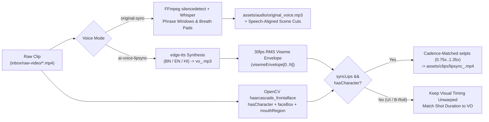

# Video Studio — Continuous Product & UX Research (`Wave 4 / V3`)

**Status:** Active Continuous Discovery & V3 Specification  
**Owner:** Product Management & UX Research (`product-manager`)  
**Companion Machine-Readable Feed:** [`studio-hub/docs/pm-insights.json`](file:///d:/B-2%20--%20Book%20PDF%20Buisness/antigravity%20video/studio-hub/docs/pm-insights.json) (`GET /api/pm-insights`)  
**North Star:** Make Video Studio (`http://localhost:4400`) the **#1 free, 100% local-first AI video editor on earth** — combining NLE precision, spatial canvas thinking, multilingual voice/lip-sync, and pre-publish performance creative intelligence with zero cloud lock-in and `$0` API cost.

---

## 1. Gap Analysis: Why Existing Editors Fail Modern Creators & Marketers

Empirical review of real-world creator workflows (including our live `capcut-1118-showcase` Bengali agro-wholesale pitch reel and SaaS launch films) exposes four structural gaps in current cloud and desktop editors:

| Market Pain Point | Cloud AI Editors (Captions / HeyGen / Runway) | Traditional Desktop NLEs (CapCut / Premiere) | Video Studio Local-First Solution |
| --- | --- | --- | --- |
| **Voice vs. Authenticity Tradeoff** | Overwrites authentic founder/shopkeeper speech with synthetic voices or charges per-minute dubbing credits. | Manual waveform razor-cutting of `um`s, pauses, and breath gaps takes 30+ minutes per reel. | **Dual-Mode Voice Engine:** 1-click **Original Voice Auto-Sync** (`silencedetect` + Whisper phrase cuts) OR **Multilingual AI Voice (`Bengali`, `English`, `Hindi`) + OpenCV Lip-Sync** at `$0`. |
| **Linear Track Rigidity** | Black-box prompt -> full video; impossible to pick *which* 3 raw clips combine into Scene 2. | Multi-lane magnetic timelines overwhelm non-editors before story structure is clear. | **Spatial Footage + Note Whiteboard:** Drag raw clips + sticky-note prompts onto a minimal canvas, wire them into a Scene Node, and compile into `STORYBOARD.json`. |
| **Post-Spend Ad Failure** | No creative diagnostics, or requires connecting paid Meta/TikTok ad accounts *after* spend is wasted. | Zero awareness of 3s thumbstop hooks, muted-feed comprehension, or platform UI overlays. | **100% Offline Pre-Publish Ad Analytics:** Deterministic `3s Hook Score`, second-by-second `Retention Curve`, `Sound-Off Score`, `TikTok/Reels/Shorts Safe Zones`, and 1-click A/B Hook testing. |
| **Paywalls & Privacy** | Watermarks, upload bottlenecks on 4K raw files, cloud retention of private client footage, recurring SaaS fees. | Increasingly bloated with cloud login gates, coin packs, and template upsells. | **100% Local Disk Ownership:** Runs offline on Node + React 19 + FFmpeg + OpenCV + Edge-TTS + Headless Chrome. |

---

## 2. Feature Specification 1 — Original Video Voice Sync vs. Multilingual AI Voice & Character Lip-Sync

**Backend Module:** `studio-hub/voice-lipsync.mjs` (`@sound-designer`)  
**REST Endpoints:** `GET /api/voices`, `POST /api/projects/:slug/voice-sync` (`@api-architect`)  
**UI Surface:** `VoiceAndLipSyncCard.jsx` mounted inside **Step 3 (`Brand & goal`)** (`@react-canvas-studio`)

### 2.1 User Experience & White-Mode UI Contract

1. **Primary Mode Switch (Segmented Control, Sentence Case, Zero Emojis):**
   - **`Use original video voice (auto-sync)`** *(Default when uploaded raw video contains detected speech)*
   - **`Generate AI voice`** *(Default when raw footage is silent screen-recording/B-roll or when localizing into a new language)*
2. **When `Use original video voice (auto-sync)` is active:**
   - Displays detected speech status (e.g., `Detected spoken audio · Bengali · 25.6s`) and a clean toggle: `Trim dead pauses automatically` (`trimSilence = true`).
   - Clicking **`Apply voice setup`** extracts `assets/audio/original_voice.mp3`, detects spoken phrase boundaries, aligns storyboard scene cut windows (`rawTimeRange`) to natural sentences so no cut slices mid-word, and preserves `80ms–120ms` natural breath pads.
3. **When `Generate AI voice` is active:**
   - **Language Selector Pills:** **`Bengali`** | **`English`** | **`Hindi`** (filters `GET /api/voices?lang=...`).
   - **Curated Neural Voice Dropdown (`VOICE_CATALOG`):**
     - **Bengali (`bn-BD` / `bn-IN`):** `bn-BD-PradeepNeural` (Male, Warm Commercial), `bn-BD-NabanitaNeural` (Female, Clear Conversational), `bn-IN-BashkarNeural` (Male, Narrative), `bn-IN-TanishaaNeural` (Female, Expressive).
     - **English (`en-US` / `en-GB` / `en-IN`):** `en-US-ChristopherNeural` (Male, Studio Authority), `en-US-AriaNeural` (Female, Crisp Launch), `en-GB-RyanNeural` (Male, Editorial), `en-IN-NeerjaNeural` (Female, Modern Product).
     - **Hindi (`hi-IN`):** `hi-IN-MadhurNeural` (Male, Confident Retail), `hi-IN-SwaraNeural` (Female, Warm Explainer).
   - **On-Camera Lip-Sync Toggle:** Checkbox **`Sync character lips on camera`** (`syncLips = true` by default) — labeled positively for its ON state per `better-writing`.
   - **Script Preview & Speaking-Rate Guardrail:** Editable script textarea showing live word count and estimated pace against language-specific clarity ceilings (`<= 3.4 words/sec` English, `<= 3.0 words/sec` Bengali, `<= 3.1 words/sec` Hindi).

### 2.2 Technical & Signal-Processing Invariants

- **Mouth ROI Geometry:** When `cv2.CascadeClassifier('haarcascade_frontalface_default.xml')` detects an on-camera speaker across sampled frames (`hasCharacter: true`), `mouthRegion` is computed deterministically in the lower third of `faceBox` (`x + 0.22*w`, `y + 0.62*h`, `0.56*w`, `0.30*h`) and stored so both lip-sync cadence matching and `signature-reel-style` safe-placement avoid covering the speaker's mouth/eyes with text!
- **Natural Optical Speed Clamp (`0.75x .. 1.35x`):** When `syncLips` adapts video `setpts` to match generated VO duration and syllable bursts, playback rate **must** clamp within `[0.75, 1.35]` (trimming or extending tail frames beyond that bound) so head/hand gestures never look jittery or hyper-accelerated.

---

## 3. Feature Specification 2 — Node-Based Footage + Note Whiteboard Scene Builder

**Backend Module:** `studio-hub/whiteboard-graph.mjs` (`@scene-pack-1`)  
**REST Endpoints:** `GET/POST /api/projects/:slug/whiteboard`, `POST /api/projects/:slug/whiteboard/compile-scene` (`@api-architect`)  
**UI Surface:** `WhiteboardCanvas.jsx` mounted as an optional mode tab in **Step 1 / Step 4** (`@react-canvas-studio`)

### 3.1 Spatial UX Model ("Think on a Board, Compile to a Scene")

Instead of forcing users to splice sub-clips in an intimidating timeline before generating storyboard frames, the **Scene Whiteboard** provides a calm, tactile spatial surface:

1. **White-Mode Dotted Stage:** `#FBFBFA` background with subtle `24px` dot grid (`radial-gradient(oklch(0 0 0 / 0.12) 1px, transparent 1px)`), concentric `16px`-radius `#FFFFFF` node cards, and `1.5px` SVG cubic Bezier wires (`stroke: #111111` active, `#787774` idle).
2. **Three Minimal Node Primitives:**
   - **`Footage card` (`type: "footage"`):** Created in 1 click from any uploaded project clip; displays `1px` outlined thumbnail, clip title, inline `Start (s)` / `End (s)` trim inputs (`trimRange`), and right-edge output port.
   - **`Sticky note` (`type: "note"`):** Muted warm-pastel surface (`#FBF3DB` ink `#956400`, per `minimalist-ui`) holding plain-language staging/editing direction (e.g., *"Cut dead air at start, highlight 5 seed packets, emerald badge"*), with right-edge output port.
   - **`Scene node` (`type: "scene"`):** Target collector card with left-edge input port, `Transition` pill (`Cut` | `Crossfade`), combined scene prompt input, and primary `#111111` button **`Create scene from connected nodes`**.
3. **Zero-Friction Wiring:** Clicking an output port and clicking (or dragging to) a `Scene node` input port draws a smooth Bezier edge (`M x1 y1 C cx1 cy1, cx2 cy2, x2 y2`); clicking an edge removes it.

### 3.2 Deterministic Graph-to-Scene Compilation Invariants

- **Persistence:** Saved at `projects/<slug>/.studio/whiteboard.json` (`nodes[]`, `edges[]`).
- **Ordering Rule:** Connected `footage` nodes feeding `sceneNodeId` sort deterministically by spatial flow (`x` ascending, tie-broken by `y` ascending or edge creation order) so left-to-right visual order on the whiteboard equals chronological playback order in the compiled clip.
- **FFmpeg Normalization Guarantee:** Heterogeneous clips (e.g. a `1920x1080` screen capture wired to a `1080x1920` phone clip at `29.97fps` HEVC) are normalized to exact project `width × height`, `30 fps`, `libx264`, `yuv420p` before `concat` / `xfade`, outputting `assets/clips/wb_scene_<id>.mp4` with zero codec mismatch errors, updating `STORYBOARD.json`, and rendering the fresh 1080p Hero Design Frame PNG immediately.

---

## 4. Feature Specification 3 — Pre-Publish Ad Creative & Retention Analytics (100% Offline)

**Backend Module:** `studio-hub/ad-analytics.mjs` (`@scene-pack-2`)  
**REST Endpoints:** `GET/POST /api/projects/:slug/ad-analytics` (`@api-architect`)  
**UI Surface:** `AdAnalyticsPanel.jsx` mounted in **Step 4 / Step 5** (`@react-canvas-studio`)

> [!IMPORTANT]
> **Strict Privacy & Scope Boundary:** Ad Creative Analytics evaluates the video creative **before publishing** using deterministic visual, typographic, timing, contrast, and motion telemetry on disk. It requires **zero external Meta/TikTok/Google ad-account OAuth or post-spend CSV imports**.

### 4.1 Five Diagnostic Outputs & Scoring Formulas

1. **`thumbstopHookScore` (`0–100`) — First `3.0s` Scroll-Stop Audit (`frame_01`)**
   - **Motion Energy (`25 pts`):** High-velocity optical rig (`crash-zoom-in`, `dolly-out-reveal`, `spotlight-cursor-follow`, `isometric-3d-tilt`, or `Math.abs(toScale - fromScale) >= 0.18`).
   - **Hook Copy Economy (`25 pts`):** `staging.headline` present and scannable in one glance (`2–7 words` optimal; penalizes missing headline or `> 10` word paragraphs).
   - **Contrast & Legibility (`20 pts`):** Foreground/background WCAG luminance ratio `>= 4.5:1` (`>= 7.0:1` bonus).
   - **Subject / Focal Anchor (`15 pts`):** Presence of human face/character keyframe, custom `aiBackgroundPlate`, or tight focal zoom.
   - **Immediate Sonic Hook (`15 pts`):** Non-empty `audioSpec.sfx` (`whoosh`, `pop`, `riser`) or voiceover hook starting in Scene 1.

2. **`retentionCurve` (`[{ second, retentionPct, event, risk }]`) & `dropOffRisks`**
   - Simulates viewer retention second-by-second from `t = 0` (`100%`) to `totalDurationSeconds`:
     - `0s–3s` slope governed by `thumbstopHookScore`.
     - Every visual pattern interrupt (cut boundary, camera preset switch, callout reveal, speed ramp `> 1.15x`) stabilizes the curve.
     - Any continuous static/low-motion dwell exceeding `3.5s` accelerates retention decay and emits a `dropOffRisks` item (`{ timeRange, reason, fixPrompt }`) rendered as a subtle Pale Red (`#FDEBEC` / `#9F2F2D`) highlight band on the inline SVG chart!

3. **`soundOffScore` (`0–100`) — Muted Feed Comprehension**
   - Over `65%` of social feed impressions start muted. Scores whether a viewer understands the hook, core value/product proof, and CTA solely from `headline`, `subheadline`, `badgeText`, `calloutItems`, and `captionText` without audio.

4. **`platformSafeZones` — `TikTok`, `Instagram Reels`, and `YouTube Shorts` Overlay Audit**
   - Evaluates active `9:16` (`1080×1920`) layout zones against platform UI chrome:
     - **TikTok:** Top `150px`, Right engagement rail `162px` (`x: 918..1080`, `y: 760..1650`), Bottom caption/music deck `360px` (`y: 1560..1920`).
     - **Instagram Reels:** Top `140px`, Right rail `150px` (`x: 930..1080`, `y: 900..1680`), Bottom CTA/audio bar `340px` (`y: 1580..1920`).
     - **YouTube Shorts:** Top `140px`, Right rail `156px` (`x: 924..1080`, `y: 820..1640`), Bottom subscribe/title bar `380px` (`y: 1540..1920`).
   - Returns `{ platform, status: "pass" | "warning", message }` per platform and guides copy into the unobstructed **Chest Optical Zone (`y = 1040–1260px`)** or **Upper Editorial Zone (`y = 220–360px`)**.

5. **`hookVariants` — 3 Instant 1-Click A/B Hook Directions**
   - Generates 3 tailored Scene 1 alternatives derived from the project's actual brief, brand offer, and product domain:
     1. **`Problem-Agitation Hook`** — Names the costly mistake/friction in `<= 6` words + `crash-zoom-in`.
     2. **`Bold Offer / Proof Hook`** — Leads with the concrete metric/price/guarantee in `badgeText` + `headline` + `isometric-3d-tilt`.
     3. **`Visual Pattern-Interrupt Hook`** — Tight detail reveal + cursor/spotlight ignition (`spotlight-cursor-follow` / `dolly-out-reveal`).
   - Clicking **`Test this hook on Scene 1`** executes `regenerateShot("frame_01", { prompt: variant.prompt, motionPreset: variant.motionPreset })`, preserving prior Scene 1 versions in `frame_01.history` for effortless comparison!

---

## 5. Top 5 Next-Horizon UX Differentiators (Roadmap to #1 Free Local AI Video Editor)

To widen Video Studio's lead over every cloud SaaS and traditional desktop NLE while staying 100% local and `$0`:

### Differentiator 1: Beat-Quantized Magnetic Cuts & Velocity Ramps
- **Insight:** Amateur AI edits cut on arbitrary decimal timestamps, whereas elite editors cut on drum transients and consonant onsets.
- **Local Implementation:** Wire `sound-engine.mjs:detectAudioBeats` directly into `storyboard.mjs` and `video-compiler.mjs` to quantize every `data-start` seam and `cut-the-curve` peak velocity frame (`Math.floor(frameIndex) / 30`) to the nearest musical beat or speech transient within `±180ms`.

### Differentiator 2: Offline Subject Matte Occlusion ("Headline Behind Speaker")
- **Insight:** Our `captions-overlay` skill defines `embed` (a scarce climax word composited *behind* the speaking subject via matte occlusion) as the signature mark of high-craft creator reels.
- **Local Implementation:** Add an offline local Python segmentation pass (cached ONNX `rembg` / MediaPipe selfie matte on keyframes/clips) producing a foreground WebM/PNG alpha layer so `scene_XX.html` sandwiches `z-index: 1` background video -> `z-index: 2` giant `embed` display word -> `z-index: 3` speaker foreground cutout -> `z-index: 4` verbatim lower-third `rail`.

### Differentiator 3: Saliency-Guided Multi-Aspect Batch Export (`9:16` + `16:9` + `1:1`)
- **Insight:** Creators shooting once need Reels/Shorts (`9:16`), YouTube/Website (`16:9`), and Feed (`1:1`) deliverables without manually rebuilding layouts three times.
- **Local Implementation:** Combine `voice-lipsync.mjs` `faceBox` coordinates and `storyboard.mjs` `cursorTarget` coordinates as a unified saliency anchor `(anchorX, anchorY)`, re-centering video crops and reflowing `LAYOUT_ARCHETYPES` CSS tokens in a single 1-click multi-aspect batch queue.

### Differentiator 4: Content-Hashed Delta Scene Patching (`< 2s` Iterative Re-Exports)
- **Insight:** Waiting 25–40 seconds to re-render an entire MP4 after fixing a single word in Scene 5 breaks creative flow.
- **Local Implementation:** Store SHA-256 hashes of each `compositions/scene_XX.html` + its sliced clip + active CSS vars in `.studio/render-cache.json`. When only Scene 5 changes, capture and encode only Scene 5 via HyperFrames and stream-copy stitch cached MP4 segments via FFmpeg in under 2 seconds.

### Differentiator 5: Portable `.studioskills` Creative Packs (Zero-Cloud Team Sharing)
- **Insight:** Agencies and creator teams want repeatable house styles without proprietary cloud workspaces.
- **Local Implementation:** Extend `skills-registry.mjs` (`installSkillToLocal`) to import/export self-contained skill folders bundling `SKILL.md` + `ledger.json` (`motion-doctrine` seam vectors) + `color-grade.mjs` LUT recipe + `sound-engine.mjs` SFX palette — shareable via Git, USB, or zip with zero accounts.
