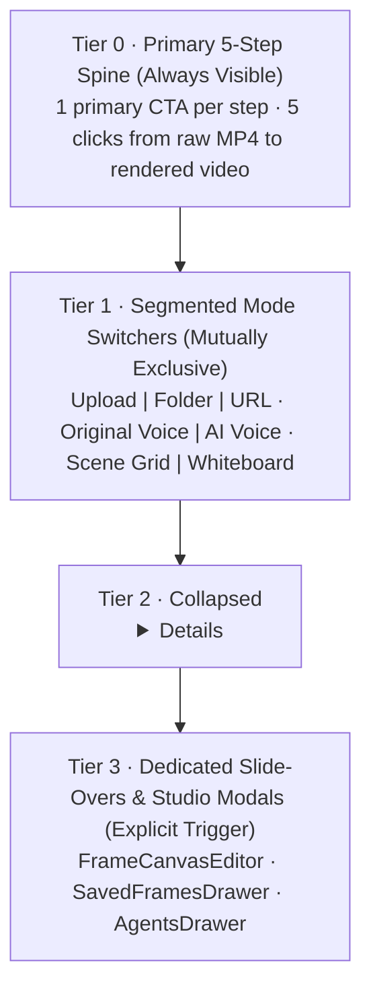

# Video Studio V4 — Feature Cohesion Audit & Progressive-Disclosure UX Specification

**Status:** Approved Wave 6 / V4 Release Architecture  
**Owner:** Product Management & UX Research (`product-manager`)  
**Companion Specs:** [`PRODUCT_SPEC_V2.md`](file:///d:/B-2%20--%20Book%20PDF%20Buisness/antigravity%20video/studio-hub/docs/PRODUCT_SPEC_V2.md) · [`PM_CONTINUOUS_RESEARCH.md`](file:///d:/B-2%20--%20Book%20PDF%20Buisness/antigravity%20video/studio-hub/docs/PM_CONTINUOUS_RESEARCH.md) · [`pm-insights.json`](file:///d:/B-2%20--%20Book%20PDF%20Buisness/antigravity%20video/studio-hub/docs/pm-insights.json)  
**Design Mandate:** A first-time creator must go from raw clip to finished MP4 in **5 calm clicks**, while a power director has **1-click local access** to beat quantization, offline speaker matte occlusion, multi-aspect smart reframe, node whiteboarding, draw-on-frame regional inpainting, `rea-video` reverse engineering, multilingual lip-sync, A/B thumbnails, and broadcast `.srt`/`.vtt`/`.ass` exports — **with zero visual clutter**.

---

## 1. The V4 UX Law: "Calm Linear Spine, Deep On-Demand Craft"

When an editor grows from 6 features to 30+ capabilities across Waves 1–6, naive UI stacking destroys usability. Video Studio V4 prevents cockpit bloat through a strict **Four-Tier Progressive Disclosure Model** governed by `minimalist-ui`, `better-layout`, `better-ui`, and `better-writing`:

### 1.1 Progressive-Disclosure Rules (Binding Across All Components)

1. **The 5-Click Beginner Fast Path Must Never Gain Mandatory Stops:**
   - **Step 1:** Click `Use this video` (or drop a file) -> `Continue to inspiration ->`
   - **Step 2:** Click `Skip` (or `Continue to brand ->`)
   - **Step 3:** Click `Save & generate design frames ->`
   - **Step 4:** Click `Approve all frames` -> `Continue to generate video ->`
   - **Step 5:** Click `Generate video` -> `Download MP4`
   - *Rule:* No Wave 4–6 pro tool may block, gate, or inject a mandatory modal into this 5-step spine.
2. **One Input Surface Per Card (Segmented Exclusivity):**
   - Never show File Dropzone + Folder Scanner + URL Input stacked vertically; keep the 3-tab segmented switcher (`Upload file` | `Local folder path` | `Video link`).
   - Never show Scene Grid and Node Whiteboard stacked simultaneously; toggle cleanly via `Scene grid` | `Scene whiteboard` (`boardMode`).
   - Never show Original Voice settings and AI TTS controls simultaneously; toggle via `Use original video voice (auto-sync)` | `Generate AI voice`.
3. **Default-Collapsed `
` for Specialist Power Belts (`ProToolsBelt.jsx`):**
   - `<ProToolsBelt mode="storyboard" />` in `StepFourStoryboard.jsx` and `<ProToolsBelt mode="export" />` in `StepFiveExport.jsx` **must render collapsed by default** (`open` omitted on initial mount), separated only by `1px solid #EAEAEA` hairlines (`minimalist-ui` §5), revealing crisp verb-first action cards only when expanded.
   - Raw compiler stdout (`Show technical log`), shot-by-shot `rea-video` `VIDEO.md` tables, optional audio uploads, and manual camera/timing sliders inside `FrameCanvasEditor.jsx` likewise remain collapsed by default.
4. **Anti-Slop Visual & Copy Continuity:**
   - Every V4 surface (`ProToolsBelt.jsx`, thumbnail galleries, subtitle download pills, reframe previews) adheres strictly to White Mode (`#FBFBFA` / `#FFFFFF`), `Geist` + `Geist Mono` (`tabular-nums`), concentric `16px = 8px + 8px` radii, `1px oklch(0 0 0 / 0.1)` outlines on all generated thumbnails/mattes, `scale(0.96)` active press, **zero emojis (`0`)**, zero CSS gradients, and plain verb-first sentence-case labels.

---

## 2. Complete V1–V4 Feature Cohesion Matrix (`Steps 1..5`)

Every backend module across Waves 1–6 maps to **one canonical home** in the 5-step journey with zero duplicate controls:

| Step | Primary Beginner Spine (`Tier 0 / 1`) | Progressive Pro Capabilities (`Tier 2 / 3`) | Backing Modules & HTTP Router |
| --- | --- | --- | --- |
| **1. Raw footage** | Loose workspace video notice (`Use this video`), `Upload file` \| `Local folder path` \| `Video link`, clip scene detector (`Analyze scenes`). | Optional `Scene whiteboard` mode (`WhiteboardCanvas`) to wire multiple clips + sticky notes before Step 4. | `lib.mjs`, `folder-ingest.mjs`, `media_intelligence.py`, `whiteboard-graph.mjs` (`routes-v3`) |
| **2. Inspiration** | Reference video upload/URL + fast `Analyze style` 3-stat card (`Average cut`, `Pacing`, `Cuts/min`, swatches, 6 style frames) + `Skip`. | **`Deep animation & style breakdown (rea-video)`** -> 4-metric strip + contact sheet + collapsed `VIDEO.md` timeline + `Apply style to design frames`. | `media_intelligence.py`, `rea-inspiration.mjs` (`routes-v3`) |
| **3. Brand & goal** | Brand logo/PDF/font upload + `Auto-fill colors from brand` + 4 color pickers + brief textarea + compact `SkillsAndRatingPanel` + `VoiceAndLipSyncCard` (`Original voice` vs `Bengali`/`English`/`Hindi` AI lip-sync). | `+ Install or create skill` (library / folder / inline Markdown) + `.studioskills` bundle import/export (`skill-bundles.mjs`) + `
Optional: Voiceover & audio files
`. | `media_intelligence.py`, `skills-registry.mjs`, `skill-bundles.mjs` (`routes-v2`, `routes-v4`), `voice-lipsync.mjs` (`routes-v3`) |
| **4. Design frames** | `Clean frame` \| `Animation guide` toggle, `Rating: XX · Grade` pill, Concentric Scene Grid (`10` archetypes incl. `depth-text-behind-speaker`, `podcast-dual-split`, `hook-scroll-stopper`, `product-price-reveal`), `Approve / Lock`, `Save`. | **Modal (`Tier 3`):** `FrameCanvasEditor` (Brush/Box/Arrow/Pin regional regen) & `SavedFramesDrawer`. **Expandable (`Tier 2`):** Full `SkillsAndRatingPanel` (1-click fixes), `AdAnalyticsPanel` (3s hook, retention curve, TikTok/Reels/Shorts safe zones, 3 A/B hooks), `WhiteboardCanvas`, and **`<ProToolsBelt mode="storyboard" />`** (`Snap scene cuts to audio beats`, `Extract speaker foreground matte`, `Preview multi-format smart reframe`). | `storyboard.mjs`, `frame-inpaint.mjs`, `video-rating.mjs` (`routes-v2`), `ad-analytics.mjs` (`routes-v3`), `beat-quantizer.mjs`, `subject-matte.mjs`, `smart-reframe.mjs`, `pack-behind-speaker.mjs`, `pack-social-hooks.mjs` (`routes-v4`) |
| **5. Generate video** | Format (`9:16`..`4:5`), Quality (`draft`/`looks`/`delivery`), Resolution, FPS, Captions, Color look, optically nudged `Generate video` CTA, 5-step plain-English checklist, Master `<video>` player + `Download MP4`. | **`<ProToolsBelt mode="export" />`** (collapsed `
`): `Generate 3 cover thumbnails (A/B/C)` (`thumbnail-ab-gen.mjs`), `Export subtitle files (.srt · .vtt · .ass)` (`subtitle-exporter.mjs`), `Generate Bengali / English / Hindi ad variant plans` (`local-batch-runner.mjs`), transparent SHA-256 `delta-cache.mjs` acceleration, compact `AdAnalyticsPanel`, and `
Show technical log
`. | `video-compiler.mjs`, `color-grade.mjs`, `captions-engine.mjs`, `sound-engine.mjs`, `delta-cache.mjs`, `thumbnail-ab-gen.mjs`, `subtitle-exporter.mjs`, `local-batch-runner.mjs` (`routes-pro`, `routes-v4`) |
| **Global Shell** | `256px` left `Sidebar` (`#step-1`..`#step-5` URL hash sync, project switcher, Light/Dark `applyThemeWithoutSmear`). | **`AgentsDrawer` (`Tier 3`):** 6-Agent crew telemetry, `$0` subscription guard toggle, CLI tool health, 1-click Antigravity queue. | `agent-bridge.mjs`, `google-flow-playbook.mjs` (`server.mjs`, `routes-pro`) |

---

## 3. Cross-Engine Cohesion & Data-Integrity Invariants

To ensure all 12 Wave 6 modules interlock cleanly with Waves 1–5 without regressions:

### 3.1 `locked: true` Frame Sovereignty Across Batch Operations
- **Rule:** Whenever a user locks/approves a frame (`frame.locked === true`), batch storyboard mutators — including `generateStoryboard` (`storyboard.mjs`), `applyInspirationStyleToStoryboard` (`rea-inspiration.mjs`), and `quantizeStoryboardToBeats` (`beat-quantizer.mjs`) — **must preserve locked frames untouched** (modifying only unlocked shots, or adjusting transition boundaries without clobbering locked staging/artwork).
- Single-shot surgical edits (`FrameCanvasEditor` -> `regenerateFrameRegion`, or 1-click `Test this hook on Scene 1` when explicitly clicked by the user) remain allowed and always push prior versions onto `frame.history[]` (`v1..vN`).

### 3.2 Speaker Matte -> Depth Archetype Pipeline (`subject-matte.mjs` <-> `pack-behind-speaker.mjs`)
- Running **`Extract speaker foreground matte`** in `<ProToolsBelt mode="storyboard" />` (`POST /api/projects/:slug/subject-matte`) extracts a feathered RGBA cutout via local OpenCV (`CascadeClassifier` + `grabCut`, `$0` offline) into `projects/<slug>/assets/images/matte_<name>.png`.
- When paired with the `depth-text-behind-speaker` scene archetype (`pack-behind-speaker.mjs`), the composition layers:
  1. `z-index: 1` — Background video/plate
  2. `z-index: 2` — Scarce climax display headline (`captions-overlay` `embed` doctrine)
  3. `z-index: 3` — Optional `shot.subjectMatteSrc` RGBA foreground speaker cutout (gracefully omitting layer 3 without broken `` icons when `subjectMatteSrc` is unset)
  4. `z-index: 4` — Lower-third verbatim `rail` captions.

### 3.3 Frame-Exact `1/fps` Beat Quantization (`beat-quantizer.mjs` <-> `hyperframes` Contract)
- `quantizeStoryboardToBeats` (`POST /api/projects/:slug/beat-quantize`) snaps unlocked cut boundaries within `±maxSnapSec` (`0.35s`) to detected musical/speech onsets (`sound-engine.mjs:detectAudioBeats`) quantized to exact frame boundaries (`Math.round(t * fps) / fps`, 6-decimal precision at `30fps`), upholding the `signature-reel-style` and `/hyperframes` deterministic clock contract.

### 3.4 Saliency Coordinate Consistency (`smart-reframe.mjs` <-> `storyboard.mjs` `0..100` Scale)
- `computeSmartReframePlan` (`POST /api/projects/:slug/smart-reframe`) combines OpenCV `faceBox` centers (`voice-lipsync.mjs`) with shot `cameraMotion.{focusX, focusY}` (`0..100`% scale) so reframing a `9:16` vertical reel into `16:9` YouTube or `1:1` Feed keeps speakers' eyes/faces and product cursor targets centered without head-cropping.

### 3.5 Content-Addressed Delta Scene Cache Safety (`delta-cache.mjs`)
- `computeSceneContentHash` hashes `{ frame, sceneHtml, clipPath, audioSpec, width, height, fps }`. Any edit to a shot's regional mask, headline, voiceover, color look, or aspect ratio produces a distinct SHA-256 digest in `projects/<slug>/.studio/scene-cache/`, guaranteeing **zero stale frames** while making single-scene re-exports near-instant via `ffmpeg -f concat -safe 0` (`shell: false`).

### 3.6 End-to-End Multilingual Script Fidelity (`Bengali` · `English` · `Hindi`)
- Unicode strings (`বাংলা`, `हिन्दी`, `English`) must round-trip losslessly with explicit UTF-8 encoding (`PYTHONIOENCODING="utf-8"`, UTF-8 BOM/headers where required) across:
  - `voice-lipsync.mjs` (`edge-tts` neural voices)
  - `storyboard.mjs` & `thumbnail-ab-gen.mjs` (Headless Chrome HTML/PNG rendering with `Hind Siliguri` & `Nirmala UI` font fallbacks)
  - `subtitle-exporter.mjs` (`.srt`, `.vtt`, and styled `.ass` files served via `/media/:slug/output/...`)
  - `local-batch-runner.mjs` (`.studio/variants/variant_<lang>.json` localized A/B ad plans).

---

## 4. Final Integration & Mounting Checklist (`@tech-pm` & `@v2-chief-qa`)

1. **HTTP Router Dispatch Order (`studio-hub/server.mjs`):**
   - Mount `handleV4Routes` (`./routes-v4.mjs`) alongside `handleV3Routes`, `handleV2Routes`, and `handleProRoutes` (passing `{ broadcastEvent }`), ensuring unmatched paths return `false` without touching `res`.
2. **Catalog Registration (`studio-hub/routes-pro.mjs` / `storyboard.mjs`):**
   - Expose the 4 Wave 6 HyperFrames scene archetypes (`depth-text-behind-speaker`, `podcast-dual-split`, `hook-scroll-stopper`, `product-price-reveal`) in `/api/catalog/presets` so they are selectable in `FrameCanvasEditor` and `StepFourStoryboard`.
3. **Zero-Clutter UI Mounts (`StepFourStoryboard.jsx` & `StepFiveExport.jsx`):**
   - Mount `<ProToolsBelt mode="storyboard" />` cleanly below the Scene Grid (above the step footer) in `StepFourStoryboard.jsx` — **collapsed by default**.
   - Mount `<ProToolsBelt mode="export" />` cleanly below the Export/Player cards (above the step footer) in `StepFiveExport.jsx` — **collapsed by default**.
   - Verify generated cover thumbnails (`variant_a_hook.png`, `variant_b_split.png`, `variant_c_spotlight.png`) and subtitle links (`.srt`, `.vtt`, `.ass`) resolve through `/media/:slug/output/...` with `1px oklch(0 0 0 / 0.1)` image outlines.
4. **Showcase Pre-Population (`projects/capcut-1118-showcase/`):**
   - Confirm `capcut-1118-showcase` carries populated `reaBreakdown`, `latest-rating.json` (with `motion-doctrine`, `seam-craft`, `captions-overlay`, `oversized-cursor`, `rea-video`), and `ad-analytics.json` so opening `http://localhost:4400` demonstrates every V2–V4 surface immediately with real local `1118.mp4` data.
