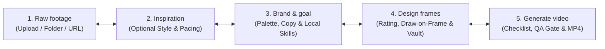
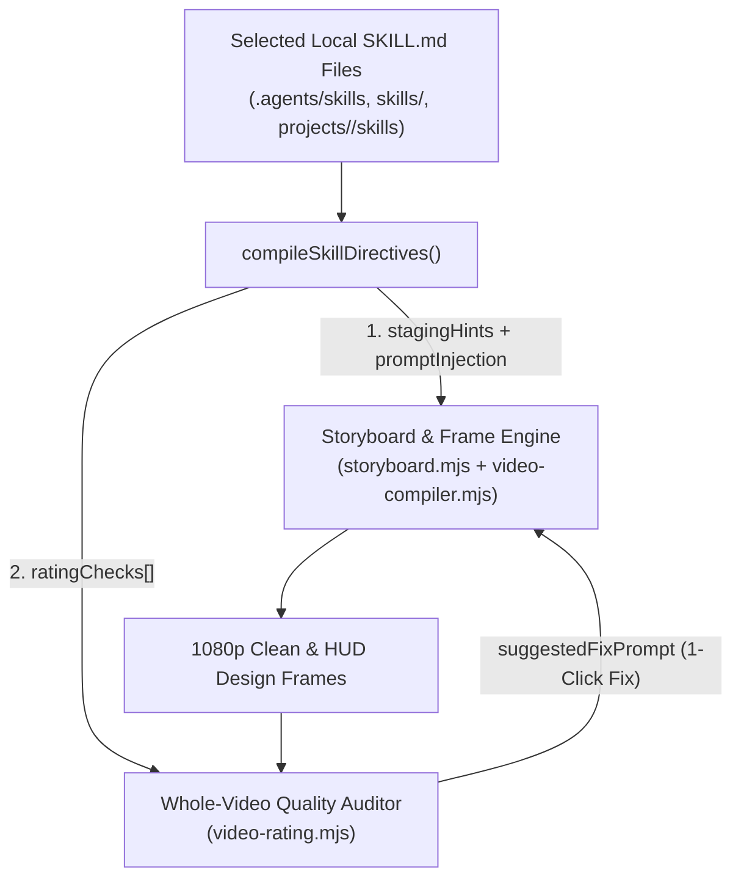

# Video Studio (Studio Hub V2) — Product & UX Specification

**Status:** Approved for V2 Production Release  
**Owner:** Product Management & UX Research (`product-manager`)  
**Runtime Target:** 100% Local-First Desktop Browser Studio (`http://localhost:4400`) on Node.js + Local React 19 (`esbuild`) + Headless Chromium + FFmpeg + HyperFrames  
**Cost Posture:** `$0` Zero-Cloud-Lock-In (`subscription-zero-dollar` guard enabled by default)

---

## 1. Executive Vision & 100% Local-First Positioning

**Video Studio (Studio Hub V2)** turns raw screen recordings, talking-head takes, local CapCut/OBS folders, brand assets, and local Markdown skill packs (`SKILL.md`) into deterministic, broadcast-grade HyperFrames MP4 videos — **entirely on the creator's local machine**.

### 1.1 Why 100% Local-First Matters

1. **Zero Cloud Lock-In & Zero Per-Minute Tax:** Every stage of ingestion, OpenCV scene cut analysis, Pillow palette quantization, PyMuPDF brand extraction, cached Faster-Whisper transcription (`local_files_only=True`), Edge-TTS narration, Headless Chrome 1080p frame rendering, React 19 UI bundling, and HyperFrames MP4 encoding runs locally on disk under `projects/<slug>/`.
2. **File-System Native Transparency:** Projects are plain directories (`PROJECT_BRIEF.json`, `STORYBOARD.json`, `AI_READY_PROMPT.md`, `index.html`, `compositions/*.html`, `assets/*`, `.studio/*`). Dropping a folder into `.agents/skills/` or a video into `DROP_HERE/` works immediately without proprietary cloud state or account walls.
3. **`$0` Antigravity Subscription Guard:** When optional generative AI tasks (`ai_storyboard_direct`, `ai_regenerate_frame`, `ai_generate_image_plate`, `ai_google_flow_video`, `ai_full_video_edit`) are queued via `agent-bridge.mjs`, `zeroCostGuard: true` enforces that reasoning and media generation use only sanctioned local tools and included Antigravity subscription workflows — never surprise paid external API keys.
4. **Deterministic Frame-by-Frame Parity:** Because storyboard Design Frames and final HyperFrames compositions both render through deterministic HTML/CSS/SVG/GSAP captured by local Headless Chrome (`chrome-headless-shell.exe`), what the user approves and annotates in Step 4 matches what compiles in Step 5.

---

## 2. White-Mode Minimal 5-Step Backable Dashboard

V2 replaces dense, multi-panel dark-mode editors with a calm, editorial, **White-Mode-First Guided Studio** governed strictly by three local design skills: `minimalist-ui`, `better-ui`, and `better-writing`.

### 2.1 Visual & Copy Invariants (Non-Negotiable)

| Domain | V2 Product Invariant | Governing Local Skill |
| --- | --- | --- |
| **Default Theme** | Boots in Light Mode (`data-theme="light"`): `#FBFBFA` canvas, `#F7F6F3` `256px` left sidebar (`1px solid #EAEAEA`), `#FFFFFF` cards, `#111111` off-black primary ink & primary CTAs, `#787774` secondary ink. Optional `[data-theme="dark"]` uses `0 0 0 1px oklch(1 0 0 / 0.08)` borders and suppresses transition smear on toggle (`applyThemeWithoutSmear`). | `minimalist-ui`, `better-ui` |
| **Typography** | `Geist Sans` / `SF Pro Display` for UI & controls; `Geist Mono` / `JetBrains Mono` for timecodes, frame numbers, and `<kbd>` shortcuts; `Instrument Serif` / `Playfair Display` reserved for editorial accents. **Ban `Inter`, `Roboto`, and `Open Sans` in Studio UI.** Tabular numerals (`font-variant-numeric: tabular-nums`) on all counters, scores, and durations. | `minimalist-ui`, `better-typography` |
| **Surfaces & Radii** | Exact 3-layer elevation (`0 0 0 1px oklch(0 0 0 / 0.06), 0 1px 2px -1px oklch(0 0 0 / 0.06), 0 2px 4px 0 oklch(0 0 0 / 0.04)`). **Concentric border radii:** `16px` outer card = `8px` padding + `8px` inner frame/thumbnail. All media previews and `<canvas>` overlays carry `outline: 1px solid oklch(0 0 0 / 0.1); outline-offset: -1px`. | `better-ui` |
| **Iconography & Anti-Slop** | **Zero emojis (`0`)** in UI markup, labels, badges, or toasts. Crisp `currentColor` SVG icons (`1.5px` stroke beside `400` text, `2px` beside `600` text). Contextual icon swaps (e.g. Sun/Moon, Lock/Unlock) crossfade with `scale(0.25 -> 1)`, `opacity(0 -> 1)`, `blur(4px -> 0)` over `300ms cubic-bezier(0.2, 0, 0, 1)`. Zero neon glows, zero SaaS gradients. | `minimalist-ui`, `better-ui` |
| **Tactile Feedback** | Buttons respond with `scale(0.96)` on `:active` (`150ms ease-out`). Play triangle icons receive an optical `+2px` X nudge (`.play-icon svg { transform: translateX(2px); }`). Transitions name exact properties (`scale, opacity, box-shadow`), never `transition: all`. | `better-ui` |
| **UX Copy** | Sentence case everywhere (`Save & generate design frames`, not `Save & Generate Design Frames`). Verb-first button labels (`Scan folder`, `Analyze style`, `Regenerate marked area`, `Apply fix`). Plain words, zero AI clichés ("Elevate", "Unleash", "Seamless", "Next-Gen"). Settings toggles describe the ON state. | `better-writing` |

### 2.2 The 5-Step Backable Flow Architecture

Only **one focused step** occupies the primary workspace at a time, anchored by a persistent `256px` left navigation rail with clickable steps (`#step-1` .. `#step-5` synced to `window.location.hash` for native browser Back/Forward support):

1. **Step 1 — `Raw footage` *(Upload or pick local folder)***
   - Surfaces a calm inline banner (`Use this video`) whenever loose `.mp4`/`.mov` files are detected in the workspace root (`status.looseRootFiles`).
   - Uses a 3-tab segmented control (`Upload file` | `Local folder path` | `Video link`) so **only one clean input pattern appears at a time**.
   - `Local folder path` scans any Windows directory (e.g. `C:\Users\...\CapCut\Videos` or OBS output) recursively and imports selected clips non-destructively into `projects/<slug>/inbox/raw-video/`.
   - Displays uploaded clips with `1px` outlined thumbnails, resolution/FPS/duration metadata, `Analyze scenes` (`media_intelligence.py analyze-raw`), and `Remove`.
2. **Step 2 — `Inspiration` *(Optional reference style)***
   - Allows uploading a reference edit or pasting a URL (`inbox/inspiration/`) + clicking `Analyze style`.
   - Renders a concise 3-metric card (`Average cut`, `Pacing` classification: `fast-kinetic` / `rhythmic-editorial` / `calm-cinematic`, `Cuts/min`), 5 quantized hex swatches, and up to 6 extracted style frames (`insp_01.png`..`insp_06.png`).
   - Explicitly skippable (`<- Back` · `Skip` · `Continue to brand ->`).
3. **Step 3 — `Brand & goal` *(Colors, fonts, script & skills)***
   - **Card 1 (`Brand identity`):** Upload Logo / Brand PDF / `.ttf`/`.otf`/`.woff2` fonts (`inbox/brand/`, auto-mirrored to `assets/fonts/` and `assets/images/`) + `Auto-fill colors from brand` + 4 semantic color pickers (`Primary`, `Secondary`, `Accent`, `Background`), clickable extracted swatches, typography family, and project language.
   - **Card 2 (`Video goal & active skills`):** Project title, Aspect Ratio (`9:16 Vertical`, `16:9 Horizontal`, `1:1 Square`, `4:5 Portrait`), Target duration (`s`), plain-English creative brief, compact `<SkillsAndRatingPanel compact={true} />` so local skills shape initial frame generation, and progressive disclosure `
Optional: Voiceover & audio files
` (Edge-TTS voice generator + BGM/SFX upload).
   - Primary CTA: **`Save & generate design frames ->`** (persists `PROJECT_BRIEF.json`, compiles selected skill directives, generates `STORYBOARD.json` + 1080p PNGs preserving any locked frames, and navigates to Step 4).
4. **Step 4 — `Design frames` *(Draw, prompt, skills & rating)***
   - Top control bar: `Clean frame` vs `Animation guide` segmented view switch, `Scene count (4..12)` + `Generate / refresh unlocked frames`, `Saved frames (N)` vault trigger, `Approve all frames`, and live **Whole-Video Rating pill** (e.g., `Rating: 92 · A+`).
   - Expandable `<SkillsAndRatingPanel />` for toggling/installing local `SKILL.md` packs, auditing the 6-category quality rubric, and executing 1-click frame fixes.
   - Concentric Scene Grid showing Scene #, timecode + speed factor, 1080p Hero Frame (`Clean` or `Animation guide` HUD), Start/Peak/End raw keyframe mini-triptych, version pill (`v1`, `v2`...), `Approve / Lock` toggle, `Save` bookmark button, and **`Edit / Draw on frame`** trigger opening `<FrameCanvasEditor />`.
5. **Step 5 — `Generate video` *(Settings & final MP4)***
   - Export settings card: Format (`9:16`, `16:9`, `1:1`, `4:5`), Quality (`draft` Fast preview, `looks` Standard crisp, `delivery` Master high quality), Resolution (`720p`, `1080p`, `4K`), Frame rate (`24`, `30`, `60`), Captions (`kinetic`, `rail`, `off`), Color look (`catalog.colorLooks`), Voiceover & ducked BGM toggles, and optically nudged **`Generate video`** CTA.
   - Plain-language 5-stage progress checklist (`1. Trimming & speed-ramping clips` -> `2. Mixing voiceover & music` -> `3. Animating scenes` -> `4. Quality & contrast check` -> `5. Exporting MP4`) with raw CLI telemetry collapsed inside `
Show technical log
`.
   - Master `<video controls>` player, render version switcher, `Download MP4`, approved frame jump strip, and `<- Back to design frames` (editing any earlier step never destroys locked frames or saved bookmarks).

---

## 3. Dynamic Local Skills Architecture (`SKILL.md` -> Staging + Rating)

Studio Hub V2 treats local Markdown skill packs (`SKILL.md`) as **first-class, hot-swappable creative directors and QA auditors** — never hardcoded presets.

### 3.1 Four-Scope Runtime Discovery & 1-Click Local Installation

Every call to `discoverLocalSkills({ slug })` (`GET /api/skills?slug=<slug>`) scans disk dynamically so dropping a new skill folder takes effect on the next refresh:

| Scope ID | Local Disk Path | Default State | Role in Studio |
| --- | --- | --- | --- |
| `project` | `projects/<slug>/skills/*/SKILL.md` | `installed: true` | Bespoke per-project brand/campaign rules |
| `workspace-agents` | `.agents/skills/*/SKILL.md` | `installed: true` | Core film grammar (`motion-doctrine`, `cut-the-curve`, `seam-craft`, `captions-overlay`, `oversized-cursor`, `signature-reel-style`, `director-studio-pro`, `changelog-video`, `hyperframes-motion-director`) |
| `workspace-skills` | `skills/*/SKILL.md` | `installed: true` | HyperFrames framework contracts (`hyperframes`, `hyperframes-cli`, `hyperframes-registry`, `media-use`, `figma`, `slideshow`, `remotion-to-hyperframes`, `reverse-any-video`) |
| `global-available` | `~/.gemini/config/skills/*/SKILL.md` | `installed: false` (unless mirrored) | User's local library (`minimalist-ui`, `better-ui`, `better-colors`, `better-typography`, `better-writing`, `brandkit`, `industrial-brutalist-ui`, `high-end-visual-design`, etc.) — ready for **1-click local copy** |

**3 Purely Local Installation Modes (`POST /api/skills/install`):**
1. **From Available Local Library:** 1-click copy from `~/.gemini/config/skills/<globalSkillId>` into `.agents/skills/` or `projects/<slug>/skills/`.
2. **From Any Local Folder Path:** Non-destructive recursive copy (`SKILL.md` + `references/` + `scripts/` + `assets/`) from any path on disk (e.g., `D:\TeamSkills\product-launch-v3`).
3. **Author Custom Skill Inline:** Enter `Skill name`, `Description`, and Markdown bullet rules directly in `<SkillsAndRatingPanel />` to write a valid YAML-frontmatter `SKILL.md` into `.agents/skills/<safeId>/SKILL.md` or `projects/<slug>/skills/<safeId>/SKILL.md`.

### 3.2 Dual-Impact Compilation: How Active Skills Shape BOTH Staging & Rating

Selecting skills (`POST /api/projects/:slug/skills`) persists `selectedSkills` in `PROJECT_BRIEF.json`, appends an `## Active Dynamic Skills` section with extracted rules to `AI_READY_PROMPT.md`, and runs `compileSkillDirectives({ slug, skillIds })` to drive **both** generation and pre-render scoring:

#### Concrete Skill-to-Behavior Matrix (Workspace Skills Ground Truth)

| Local Skill | Staging & Choreography Directives (`stagingHints`) | Dynamic Rating Audit Checks (`ratingChecks`) |
| --- | --- | --- |
| `motion-doctrine` | Enforces single dominant film current (default `LEFT`), causal motion chains, and varied shot-to-shot camera vectors (bans static lockoff repetition & idle `yoyo` wobble). | Penalizes consecutive identical `motionPreset` / static shots, ping-pong opposing seams without cause, or `speedFactor` outside `0.4x..3.0x`. |
| `cut-the-curve` | Selects velocity-matched seam pairs (`zoom-through`, `inverse-zoom`, `cut-the-curve`, `waterfall-cut`, `rack-focus`) with matching Z scale signs (`d(scale)/dt`). | Audits `transitionIn` / `transitionOut` definition and checks that Z push/pull scale directions do not fight across adjacent shots. |
| `seam-craft` | Enforces opaque `#root` stage ground (`var(--canvas-deep, #000)`) and `0/1` ping-pong track assignment on overlapping wrappers. | Verifies opaque canvas background (preventing white-flash dips on dark reels) and valid seam transition pairs. |
| `captions-overlay` | Applies `drop / rail / embed` model; centers composition on true vertical center (`y = H/2 = 960px` in 9:16) instead of shifting layout up for a dead bottom band. | Checks caption density, verifies scarce embeds, and ensures critical micro-copy is not parked in the bottom `80px` center overlay span. |
| `oversized-cursor` | Activates `spotlight-cursor-zoom` / `spotlight-cursor-follow` (`7cqw` pointer entering physically from off-screen `top: 115%` with tip-targeted `0.84` tap ignition). | Verifies at least one interactive product/UI shot stages an active `cursorTarget` (`x, y` in `0..100` stage coordinates) + spotlight preset. |
| `signature-reel-style` | Maps `1.8s–3.2s` beats onto the 5 Signature Archetypes (Hook Stack, Chest Blur-Morph Ladder `y=1040–1260px`, Step Tracker, 3D Device `perspective(1400px)`, Micro-CTA); single accent over dark studio ground. | Flags shots `> 5.0s` without visual progression, enforces WCAG AA (`>= 4.5:1`) adaptive contrast, and checks beat variety. |
| `minimalist-ui` / `better-colors` | Sets `preferMinimalPalette: true`, high-contrast editorial typography, muted accents, and raises `contrastFloor` (`>= 4.5:1` body, `>= 3.0:1` large display). | Audits palette restraint (no clashing neon multi-accents) and verifies relative luminance contrast floor across frames. |
| **Any Custom User `SKILL.md`** | Parses YAML frontmatter, hex swatches (`#[0-9A-Fa-f]{6}`), motion keywords, and top 5 bullet imperatives into `promptInjection` & `stagingHints`. | Dynamically synthesizes `ratingChecks` from the custom skill's extracted hex tokens, duration rules, and mandatory keywords. |

---

## 4. Pre-Render Whole-Video Quality Rating (`0–100` + `S / A+ / A / B`)

Before spending CPU/GPU time compiling a full MP4 in Step 5, users can click **`Rate design frames`** (`GET/POST /api/projects/:slug/rating`) in Step 4 to receive a deterministic, actionable **Whole-Video Quality Rating** saved to `projects/<slug>/.studio/latest-rating.json`.

### 4.1 Grade Scale & Readiness Gate

| Score Range | Letter Grade | Studio Readiness Meaning |
| --- | --- | --- |
| `95 – 100` | **`S`** | Broadcast / Launch-ready; passes every pacing, contrast, motion, and active skill law. |
| `90 – 94` | **`A+`** | Production-grade; minor optional polish only. |
| `85 – 89` | **`A`** | Strong narrative & visual cohesion; 1–2 shot refinements available. |
| `80 – 84` | **`B+`** | Good structure; review flagged contrast, speaking rate, or skill-alignment notes. |
| `70 – 79` | **`B`** | Watchable draft, but noticeable pacing drag, repeated lockoffs, or missing skill beats. |
| `< 70` | **`C`** | Needs storyboard refinement before final MP4 render; use 1-click **`Apply fix`** prompts. |

### 4.2 Six Weighted Category Sub-Scores (`0–100` Each)

1. **`hookAndPacing` (Weight: `20%`)**
   - Shot 1 hook duration `<= 7.0s` (`<= 3.5s` ideal for vertical reels) with non-static opening motion (`crash-zoom-in`, `dolly-out-reveal`, or kinetic headline).
   - Shot duration variance (avoids robotic identical durations across all scenes), total duration fit against `project.durationSeconds`, and alignment with `inspirationProfile.avgShotLength` when present.
2. **`visualHierarchyAndContrast` (Weight: `20%`)**
   - Computes real WCAG 2.1 relative luminance contrast ratio between resolved foreground text ink and background surface (`>= 4.5:1` target, `>= 7.0:1` AAA bonus).
   - Verifies non-empty `staging.headline` / `badgeText` and confirms rendered 1080p Hero PNGs exist on disk (`designFramePath`).
3. **`motionContinuity` (Weight: `20%`)**
   - Enforces `motion-doctrine` invariants: consecutive frames must not repeat identical static camera presets; pan/zoom vectors progress intentionally; `transitionIn`/`transitionOut` seams are defined; `speedFactor` stays within clean optical bounds (`0.4x..3.0x`).
4. **`skillAlignment` (Weight: `15%`)**
   - Evaluates `ratingChecks` compiled from every skill in `project.selectedSkills` (returning neutral/baseline high score only if zero skills are selected, and dynamically re-scoring as soon as the user toggles skills on/off!).
5. **`brandConsistency` (Weight: `10%`)**
   - Verifies custom/extracted `brandColors`, brand logo or guidelines presence (`brandKit`), font consistency, and copy language match.
6. **`audioAndCaptions` (Weight: `15%`)**
   - Checks voiceover script coverage across shots and audits **speaking rate (`words / durationSeconds <= 3.4 words/sec`)** so Edge-TTS + `atempo` never clips or sounds rushed, plus `captionText` presence.

### 4.3 Per-Frame Diagnostics & Closed-Loop 1-Click Fix (`suggestedFixPrompt`)

Every frame receives `{ frameId, index, title, score, grade, locked, strengths[], issues[], suggestedFixPrompt }`.
- **Actionable Prompt Invariant:** Whenever a frame drops points (e.g., Shot 1 is `8.5s` with a static camera, or `oversized-cursor` is active without a spotlight shot, or voiceover copy exceeds `3.4 words/sec`), `suggestedFixPrompt` **must** be a concrete natural-language instruction understood by `storyboard.mjs:parseFramePrompt` / `regenerateFrame` (e.g., *"Use Spotlight Cursor Follow preset, tighten duration to 3.2s, and bold high-contrast headline"*).
- Clicking **`Apply fix`** in `<SkillsAndRatingPanel />` runs `regenerateShot(frameId, { prompt: frameRating.suggestedFixPrompt })`, renders `vN+1` via Headless Chrome, and re-runs `evaluateProjectVideoRating` — measurably raising the score.

---

## 5. Interactive Draw-on-Frame Studio & Saved Frames Vault

Step 4's `<FrameCanvasEditor />` gives creators direct spatial control over any Design Frame — allowing repeated, surgical regional edits without clobbering the rest of the composition.

### 5.1 Resolution-Accurate Canvas & 4 Spatial Annotation Tools

`<FrameCanvasEditor />` renders the 1080p frame (`Clean frame` | `Animation guide` | `Raw keyframes`) beneath a pointer-captured HTML5 `<canvas>` (`setPointerCapture` for mouse, trackpad, and pen/stylus parity):

| Tool | Visual Stroke | User Intent | Backend Semantic Mapping (`frame-inpaint.mjs`) |
| --- | --- | --- | --- |
| **`Brush mask`** | Semi-transparent soft highlight stroke (`Small` / `Medium` / `Large`) | Paint over a badge, headline, callout card, or central subject to replace/restyle just that area | Bounding box normalized `0..1` -> classifies target semantic `zone` + exports binary white-on-black `maskDataUrl` PNG |
| **`Region box`** | Crisp dashed rectangle | Frame a precise corner, card, or lower-third region | Exact normalized `{ x, y, width, height, centerX, centerY }` -> maps to semantic `zone` |
| **`Motion arrow`** | Directional vector line + arrowhead (`p0 -> p1`) | Draw directly on the frame to command *"pan/zoom camera toward this UI button"* | Classifies `zone: "motion-trajectory"`, computes `(dx, dy)` vector & angle, and sets camera focus/pan toward arrow tip! |
| **`Pin note`** | Numbered circular callout marker (`1`, `2`...) | Drop a point-specific art direction or copy change on an exact coordinate | Normalized `{ centerX, centerY }` -> targets nearest semantic `zone` + updates pointer/spotlight reticle |

**Ink Swatches:** Coral `#E03E3E`, Amber `#D97706`, Blue `#2563EB`, Charcoal `#111111`, plus `Undo` and `Clear drawing`.

### 5.2 Semantic Zone Classification & Surgical Regional Regeneration Invariants

When the user draws on the canvas and clicks **`Regenerate marked area`** (`POST /api/projects/:slug/storyboard/frames/:frameId/regenerate-region`, supporting up to `15 MB` JSON payloads for 1080p base64 PNGs):

1. **Dual Artifact Persistence:** Decodes and saves both `<frameId>_<id>_mask.png` (binary mask) and `<frameId>_<id>_annotated.png` (frame + strokes composite) in `projects/<slug>/.studio/frames/annotations/` + metadata in `.studio/annotations.json`.
2. **Deterministic Zone Map (`0..1` Normalized Canvas Coordinates):**
   - `"motion-trajectory"` — whenever an `"arrow"` tool stroke is present (takes priority for camera choreography).
   - `"badge-header"` — `centerY < 0.22` -> mutates **only** `staging.badgeText` / top accent; preserves `headline`, `subheadline`, `calloutItems`, `cameraMotion`, and `durationSeconds`.
   - `"caption-lower-third"` — `centerY > 0.76` -> mutates **only** lower-third copy (`staging.headline` / `staging.subheadline` / `staging.captionText`); preserves device mockup, badge, and camera rig.
   - `"callout-left"` — `centerX < 0.36` and `0.22 <= centerY <= 0.76` -> updates left-side `calloutCard` (`side: "left"`) + syncs `staging.calloutItems` & pointer target.
   - `"callout-right"` — `centerX > 0.64` and `0.22 <= centerY <= 0.76` -> updates right-side `calloutCard` (`side: "right"`) + syncs `staging.calloutItems` & pointer target.
   - `"center-subject"` — `0.30 <= centerX <= 0.70` and `0.22 <= centerY <= 0.76` -> updates central subject zoom/layout/reticle focus + regional highlight overlay without altering header/footer copy.
3. **Critical Coordinate & Schema Parity Invariant (`0..1` -> `0..100`):**
   - `analyzeAnnotationRegion` outputs normalized `0..1` coordinates (`centerX`, `centerY`, arrow tip), whereas `storyboard.mjs` stores `cameraMotion.focusX`, `cameraMotion.focusY`, and `staging.cursorTarget.{x, y}` on a **`0..100` percentage scale** (e.g., `50, 44`). `regenerateFrameRegion` **must** convert `0..1` -> `Math.round(coord * 100)` when writing `cameraMotion` and `cursorTarget` so Headless Chrome renders spotlights and zoom centers accurately!
   - Likewise, `storyboard.mjs` renders `staging.subheadline` and `staging.calloutItems`; regional updates must keep `subheadline` and `calloutItems` synchronized alongside `calloutCard` so the freshly rendered `vN+1` 1080p PNG visibly reflects every regional edit.
4. **Non-Destructive Version Stack (`v1 -> v2 -> v3`):**
   - Every regeneration increments `frame.currentVersion` and appends a snapshot to `frame.history[]`, allowing instant 1-click rollback (`Restore v1`) at any time.
   - Checking `Also queue Antigravity AI art inpaint ($0)` (`enqueueAiInpaint: true`) additionally queues an `ai_regenerate_frame` ticket carrying `maskRelPath`, `compositeRelPath`, `regionAnalysis`, and `prompt` for generative plate synthesis under the `$0` subscription guard.

### 5.3 Saved Design Frames Vault (`SavedFramesDrawer`)

Creators often discover an extraordinary frame layout (`v2` of Scene 3) before experimenting further (`v3..v6`) or changing target scene counts.
- Clicking **`Save frame`** (`POST /api/projects/:slug/saved-frames`) copies the exact rendered 1080p PNG into `projects/<slug>/.studio/frames/saved/<savedId>.png` and records metadata (`savedId`, `frameId`, `version`, `label`, `notes`, `imageRelPath`, `createdAt`) in `.studio/saved-frames.json`.
- **Vault Permanence Invariant:** Because the PNG is physically copied into `.studio/frames/saved/`, bookmarked frames remain **100% intact, browsable, and downloadable** even if the originating storyboard shot is later overwritten, unlocked and regenerated, or deleted when scene count shrinks.

---

## 6. Cross-Pod Acceptance & UX Verification Checklist

Before V2 ships through `@v2-chief-qa`:

- [ ] **Zero Cloud Dependency:** App builds offline via `node studio-hub/build-ui.mjs` (`react@19.2.6` + `esbuild@0.28.2`) and boots cleanly in White Mode (`data-theme="light"`) with `0` console/page errors and `0` emojis.
- [ ] **Full 5-Step Round-Trip:** Clicking sidebar steps or `Back` / `Continue` buttons (`#step-1` <-> `#step-5`) preserves project state, selected local skills, locked frames, and saved vault frames.
- [ ] **Live Local Skill Discovery & Install:** `.agents/skills/*` and `skills/*` appear automatically; installing a skill from `~/.gemini/config/skills/*`, a local folder path, or custom Markdown immediately updates `GET /api/skills`, `AI_READY_PROMPT.md`, staging directives, and `skillAlignment` rating checks.
- [ ] **Diagnostic Rating & 1-Click Improvement:** `evaluateProjectVideoRating` differentiates weak vs. strong storyboards (`0–100`, `S..C`), enforces `<= 3.4 words/sec` VO pacing and WCAG contrast, and `suggestedFixPrompt` measurably boosts frame scores when applied.
- [ ] **Surgical Draw-on-Frame Regeneration:** Painting a mask, box, pin, or motion arrow in `<FrameCanvasEditor />` saves `_mask.png` + `_annotated.png`, updates **only** the targeted semantic zone (`0..1` mapped cleanly to `0..100` `focusX`/`focusY`), renders a real `vN+1` PNG via Headless Chrome, and preserves `v1..vN` history + Saved Frames Vault copies.
