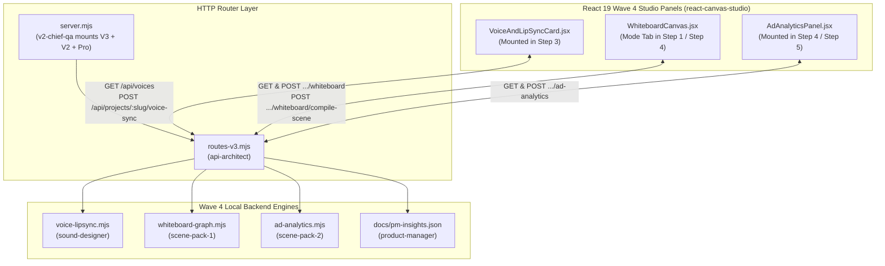

# Studio Hub V3 (Wave 4) — Voice/Lip-Sync, Node Whiteboard, Ad Creative Analytics & PM Insights Contracts

> **Owner**: `tech-pm` (`#71`)  
> **Scope**: Authoritative TypeScript/JSDoc interfaces, module export signatures, filesystem schemas, and HTTP REST JSON contracts across Wave 4 pods (`@sound-designer`, `@scene-pack-1`, `@scene-pack-2`, `@api-architect`, `@react-canvas-studio`, `@product-manager`) and final integration by `@v2-chief-qa`.  
> **Companion Spec**: Builds non-breakingly on top of `studio-hub/docs/ARCHITECTURE_CONTRACTS.md` (Wave 3 V2).

---

## 1. Wave 4 Topology & Ownership Matrix



| Pod | Owned Files | Consumers |
| :--- | :--- | :--- |
| **`sound-designer`** | `studio-hub/voice-lipsync.mjs`, `studio-hub/tests/voice-lipsync.test.mjs` | `routes-v3.mjs`, `VoiceAndLipSyncCard.jsx` |
| **`scene-pack-1`** | `studio-hub/whiteboard-graph.mjs`, `studio-hub/tests/whiteboard-graph.test.mjs` | `routes-v3.mjs`, `WhiteboardCanvas.jsx` |
| **`scene-pack-2`** | `studio-hub/ad-analytics.mjs`, `studio-hub/tests/ad-analytics.test.mjs` | `routes-v3.mjs`, `AdAnalyticsPanel.jsx` |
| **`api-architect`** | `studio-hub/routes-v3.mjs`, `studio-hub/tests/routes-v3.test.mjs` | `server.mjs`, `VoiceAndLipSyncCard.jsx`, `WhiteboardCanvas.jsx`, `AdAnalyticsPanel.jsx` |
| **`react-canvas-studio`** | `studio-hub/ui-src/components/{VoiceAndLipSyncCard,WhiteboardCanvas,AdAnalyticsPanel}.jsx` | `StepsOneToThree.jsx`, `StepFourStoryboard.jsx`, `StepFiveExport.jsx` (mounted by `v2-chief-qa`) |
| **`product-manager`** | `studio-hub/docs/PM_CONTINUOUS_RESEARCH.md`, `studio-hub/docs/pm-insights.json` | `routes-v3.mjs` (`GET /api/pm-insights`) |

---

## 2. Pod A Contract — `voice-lipsync.mjs` (`@sound-designer`)

### TypeScript / JSDoc Interfaces

```ts
export type SupportedVoiceLanguage = "Bengali" | "English" | "Hindi";

export interface NeuralVoiceSpec {
  id: string;                      // e.g. "bn-BD-PradeepNeural", "en-US-AriaNeural", "hi-IN-MadhurNeural"
  name: string;                    // e.g. "Pradeep", "Aria", "Madhur"
  language: SupportedVoiceLanguage;
  locale: string;                  // e.g. "bn-BD", "bn-IN", "en-US", "en-GB", "en-IN", "hi-IN"
  gender: "Male" | "Female";
  style: string;                   // e.g. "Warm Commercial", "Conversational", "Editorial"
  sampleRateHz: number;            // e.g. 24000
}

// Grouped by language key: VOICE_CATALOG.Bengali, VOICE_CATALOG.English, VOICE_CATALOG.Hindi
export type VoiceCatalogMap = Readonly<Record<SupportedVoiceLanguage, readonly NeuralVoiceSpec[]>>;

export interface SpeechAlignedWindow {
  index?: number;
  startTime: number;               // seconds
  endTime: number;                 // seconds
  duration: number;                // seconds
  hasSpeech: boolean;
  text: string;                    // Transcribed phrase (or "" if Whisper weights uncached)
}

export interface OriginalVoiceSyncResult {
  ok: true;
  slug: string;
  sourceVideoRelPath: string;
  audioRelPath: string;            // "assets/audio/original_voice.mp3"
  duration: number;
  hasSpeech: boolean;
  language?: string;
  segments: SpeechAlignedWindow[];
}

export interface CharacterFaceDetectionResult {
  ok?: boolean;
  hasCharacter: boolean;
  faceRatio: number;               // 0..1 fraction of sampled frames with detected face
  faceBox: { x: number; y: number; width: number; height: number } | null;   // 0..1 normalized or pixel coords
  mouthRegion: { x: number; y: number; width: number; height: number } | null;
  sampledFrames?: number;
}

export interface LipSyncedVoiceResult {
  ok: true;
  slug: string;
  frameId: string;
  language: SupportedVoiceLanguage | string;
  voiceId: string;
  scriptText: string;
  audioRelPath: string;            // "assets/audio/vo_<frameId>.mp3"
  syncedClipRelPath: string | null;// "assets/clips/lipsync_<frameId>.mp4" when syncLips && character clip aligned, else null
  durationSeconds: number;
  lipSynced: boolean;
  characterDetection: CharacterFaceDetectionResult | null;
  visemeEnvelope: number[];        // 30fps RMS normalized 0..1 mouth-open amplitude array
}
```

### Required Module Exports (`studio-hub/voice-lipsync.mjs`)

```ts
export const VOICE_CATALOG: VoiceCatalogMap;
// Required voice IDs in VOICE_CATALOG:
// Bengali: "bn-BD-PradeepNeural", "bn-BD-NabanitaNeural", "bn-IN-BashkarNeural", "bn-IN-TanishaaNeural"
// English: "en-US-ChristopherNeural", "en-US-AriaNeural", "en-GB-RyanNeural", "en-IN-NeerjaNeural"
// Hindi:   "hi-IN-MadhurNeural", "hi-IN-SwaraNeural"

export function extractAndSyncOriginalVoice(opts: {
  slug: string;
  videoRelPath?: string | null;
  trimSilence?: boolean;
}): Promise<OriginalVoiceSyncResult>;

export function detectCharacterFaceAndLips(opts: {
  videoPath: string;
}): Promise<CharacterFaceDetectionResult>;

export function generateMultilingualLipSyncedVoice(opts: {
  slug: string;
  frameId: string;
  clipPath?: string | null;
  language?: SupportedVoiceLanguage | string;
  voiceId?: string | null;
  scriptText: string;
  targetDurationSec?: number;
  syncLips?: boolean;
}): Promise<LipSyncedVoiceResult>;
```

---

## 3. Pod B Contract — `whiteboard-graph.mjs` (`@scene-pack-1`)

### TypeScript / JSDoc Interfaces

```ts
export type WhiteboardNodeType = "footage" | "note" | "scene";

export interface WhiteboardNode {
  id: string;                      // e.g. "node_footage_1", "node_note_1", "node_scene_1"
  type: WhiteboardNodeType;
  x: number;                       // Canvas X coordinate (px)
  y: number;                       // Canvas Y coordinate (px)
  title: string;
  clipRelPath?: string | null;     // For type === "footage", e.g. "inbox/raw-video/1118.mp4" or "assets/clips/..."
  trimRange?: [number, number] | null; // [startSec, endSec]
  promptText?: string;             // For "note" or "scene" nodes
}

export interface WhiteboardEdge {
  id: string;                      // e.g. "edge_1"
  from: string;                    // Source node ID (also accept `source` alias on input!)
  to: string;                      // Target node ID (also accept `target` alias on input!)
}

export interface WhiteboardGraph {
  schemaVersion?: number;
  slug?: string;
  nodes: WhiteboardNode[];
  edges: WhiteboardEdge[];
  updatedAt?: string;
}

export interface CompileWhiteboardSceneResult {
  ok: true;
  compiledClipRelPath: string;     // "assets/clips/wb_scene_<id>.mp4"
  frame: import("./ARCHITECTURE_CONTRACTS.md").StoryboardFrame;
  storyboard: import("./ARCHITECTURE_CONTRACTS.md").Storyboard;
  graph: WhiteboardGraph;
}
```

### Required Module Exports (`studio-hub/whiteboard-graph.mjs`)

```ts
export function loadWhiteboardGraph(slug: string): Promise<WhiteboardGraph> | WhiteboardGraph;
export function saveWhiteboardGraph(slug: string, graph: Partial<WhiteboardGraph>): Promise<WhiteboardGraph> | WhiteboardGraph;
export function compileWhiteboardScene(opts: {
  slug: string;
  sceneNodeId?: string | null;
  nodeIds?: string[] | null;
  prompt?: string;
  transition?: "cut" | "crossfade";
}): Promise<CompileWhiteboardSceneResult>;
```

### Cross-Pod Alignment Rules
1. **Defensive Edge/Node Normalization**: `saveWhiteboardGraph` and `compileWhiteboardScene` MUST normalize `edge.from || edge.source`, `edge.to || edge.target`, `node.clipRelPath || node.relPath`, and `node.promptText ?? node.text ?? node.prompt ?? ""`.
2. **Unsaved Graph Compile Safety**: `POST /api/projects/:slug/whiteboard/compile-scene` in `routes-v3.mjs` accepts optional `graph` (or `nodes` + `edges`) in the request body and persists it via `saveWhiteboardGraph` *before* calling `compileWhiteboardScene(...)`, so clicking **"Create scene from connected nodes"** in `WhiteboardCanvas.jsx` always compiles the live board state in 1 click!

---

## 4. Pod C Contract — `ad-analytics.mjs` (`@scene-pack-2`)

### TypeScript / JSDoc Interfaces

```ts
export interface RetentionPoint {
  second: number;                  // Integer second 0..totalDuration
  retentionPct: number;            // 0..100 estimated viewer retention percentage
  event: string;                   // What happens at this second (e.g. "Opening hook zoom", "Scene 2 cut", "Static dwell")
  risk: "low" | "medium" | "high" | null;
}

export interface DropOffRiskWindow {
  timeRange: string | [number, number]; // e.g. "6.0s–9.5s" (also include startSec, endSec numbers if helpful)
  startSec?: number;
  endSec?: number;
  frameId?: string;
  reason: string;
  fixPrompt: string;               // 1-click prompt executable by regenerateFrame()
}

export interface PlatformSafeZoneAudit {
  platform: "TikTok" | "Instagram Reels" | "YouTube Shorts" | string;
  id?: "tiktok" | "instagram-reels" | "youtube-shorts" | string;
  status: "pass" | "warning";
  passed: boolean;
  rightRailClear?: boolean;
  bottomOverlayClear?: boolean;
  issues: string[];
  summary?: string;
}

export interface AdHookVariant {
  id: string;                      // e.g. "hook_problem_agitation", "hook_bold_offer", "hook_pattern_interrupt"
  archetype?: string;              // e.g. "Problem-Agitation Hook" | "Bold Offer/Proof Hook" | "Visual Pattern-Interrupt Hook"
  name: string;                    // Display title (alias `title` / `label` optional)
  headline: string;
  subheadline?: string;
  badgeText?: string;
  motionPreset: string;            // Valid preset ID in storyboard.mjs, e.g. "crash-zoom-in", "whip-pan-split"
  layout?: string;                 // Valid archetype in storyboard.mjs
  prompt: string;                  // 1-click prompt for regenerateShot("frame_01", { prompt, motionPreset })
  rationale?: string;
}

export interface AdCreativeAnalyticsReport {
  slug?: string;
  thumbstopHookScore: number;      // 0..100
  soundOffScore: number;           // 0..100
  overallAdScore?: number;         // 0..100 optional composite
  verdict?: string;
  retentionCurve: RetentionPoint[];
  dropOffRisks: DropOffRiskWindow[];
  // Canonical array of 3 platform entries (or object keyed by platform; UI normalizes both!):
  platformSafeZones: PlatformSafeZoneAudit[] | Record<string, PlatformSafeZoneAudit>;
  hookVariants: AdHookVariant[];   // Exactly 3 concrete A/B hook variants for Scene 1
  evaluatedAt: string;
}
```

### Required Module Export (`studio-hub/ad-analytics.mjs`)

```ts
export function evaluateAdCreativeAnalytics(opts: {
  slug?: string | null;
  project?: Record<string, unknown> | null;
  storyboard?: Record<string, unknown> | null;
}): Promise<AdCreativeAnalyticsReport> | AdCreativeAnalyticsReport;
```

- **Persistence**: When `slug` is provided, persist latest report to `projects/<slug>/.studio/ad-analytics.json`.
- **Cross-Pod Safe-Zone Rule**: `@scene-pack-2` SHOULD emit `platformSafeZones` with all 3 platforms (`TikTok`, `Instagram Reels`, `YouTube Shorts`) — if returning an array, you may also attach non-enumerable `.tiktok`, `.instagramReels`, `.youtubeShorts` properties (like `MOTION_PRESETS` in `storyboard.mjs`!) so BOTH `Array.isArray(platformSafeZones)` and `platformSafeZones.tiktok` work! And `AdAnalyticsPanel.jsx` MUST accept both array and object forms!

---

## 5. Pod D Contract — `routes-v3.mjs` (`@api-architect`) & V3 REST JSON API

### Router Signature & `server.mjs` Mounting

```ts
export async function handleV3Routes(
  req: import("node:http").IncomingMessage,
  res: import("node:http").ServerResponse,
  urlObj: URL,
  deps?: {
    broadcastEvent?: (type: string, payload?: Record<string, unknown>) => unknown;
    sendJson?: (res: import("node:http").ServerResponse, status: number, data: unknown) => void;
    sendError?: (res: import("node:http").ServerResponse, status: number, message: string) => void;
    readJsonBody?: (req: import("node:http").IncomingMessage, maxBytes?: number) => Promise<Record<string, unknown>>;
    projectsDir?: string;
    voiceLipsync?: Partial<typeof import("./voice-lipsync.mjs")>;
    whiteboardGraph?: Partial<typeof import("./whiteboard-graph.mjs")>;
    adAnalytics?: Partial<typeof import("./ad-analytics.mjs")>;
    pmInsightsPath?: string;
  },
): Promise<boolean>;
```

- Returns `false` **without touching `res`** when `urlObj.pathname` does not match a V3 endpoint.
- Mount order in `studio-hub/server.mjs` (`handleApi`, wired by `@v2-chief-qa`):
  1. `if (await handleV3Routes(req, res, urlObj, { broadcastEvent })) return;`
  2. `if (await handleV2Routes(req, res, urlObj, { broadcastEvent })) return;`
  3. `if (await handleProRoutes(req, res, urlObj, { sendJson, sendError, readJsonBody })) return;`
  4. Core `server.mjs` routes.

### Complete V3 REST Endpoint Table

| # | Method & Path | Request Query / JSON Body | Response `200 OK` JSON | Side Effects / Notes |
| :- | :--- | :--- | :--- | :--- |
| **1** | `GET /api/voices` | `?lang=Bengali\|English\|Hindi` *(optional, case-insensitive)* | `{ ok: true, voices: NeuralVoiceSpec[], catalog: VoiceCatalogMap, byLanguage: VoiceCatalogMap }` | Flattens `VOICE_CATALOG` into `voices` (filtered if `?lang=` set) + includes grouped `catalog`/`byLanguage`. |
| **2** | `POST /api/projects/:slug/voice-sync` | `{ mode: "original-sync" \| "ai-voice-lipsync", videoRelPath?, frameId?, language?, voiceId?, scriptText?, targetDurationSec?, syncLips?: boolean, trimSilence?: boolean }` | `{ ok: true, mode, audioRelPath, audioUrl, syncedClipRelPath?, syncedClipUrl?, segments?, visemeEnvelope?, characterDetection?, lipSynced?, frame?, storyboard?, project? }` | Updates `STORYBOARD.json` frame audio/clip if `frameId` exists + syncs manifest; broadcasts `"storyboard_updated"`. |
| **3** | `GET /api/projects/:slug/whiteboard` | — | `{ ok: true, graph: WhiteboardGraph, nodes: WhiteboardNode[], edges: WhiteboardEdge[] }` | Loads `projects/<slug>/.studio/whiteboard.json` (returns empty `{ nodes: [], edges: [] }` if new). |
| **4** | `POST /api/projects/:slug/whiteboard` | `{ nodes, edges }` or `{ graph: { nodes, edges } }` | `{ ok: true, graph: WhiteboardGraph }` | Persists `projects/<slug>/.studio/whiteboard.json`. |
| **5** | `POST /api/projects/:slug/whiteboard/compile-scene` | `{ sceneNodeId?: string \| null, nodeIds?: string[] \| null, prompt?: string, transition?: "cut" \| "crossfade", graph?: WhiteboardGraph }` | `{ ok: true, compiledClipRelPath, compiledClipUrl, frame: StoryboardFrame, storyboard: Storyboard, graph: WhiteboardGraph }` | Saves `body.graph` first if supplied; decorates `/media/:slug/...` URLs; broadcasts `"storyboard_updated"` & `"storyboard-updated"`. |
| **6** | `GET /api/projects/:slug/ad-analytics`<br>`POST /api/projects/:slug/ad-analytics` | Optional body on `POST`: `{ project?, storyboard? }` | `{ ok: true, analytics: AdCreativeAnalyticsReport }` | Evaluates `evaluateAdCreativeAnalytics({ slug, ... })`. |
| **7** | `GET /api/pm-insights` | — | `{ ok: true, insights: PmInsightsPayload }` | Reads `studio-hub/docs/pm-insights.json` with graceful built-in fallback if missing. |

---

## 6. Pod E Contract — Wave 4 React Components (`@react-canvas-studio`)

All 3 components MUST import `{ useStudio, Icons }` from `"../store.jsx"` and `{ api, resolveMediaUrl }` from `"../api.js"`, require **zero mandatory props** (so `@v2-chief-qa` can drop them cleanly into Steps 1/3/4/5), and obey White-Mode `/better-ui` + zero-emoji rules:

1. **`studio-hub/ui-src/components/VoiceAndLipSyncCard.jsx`**:
   - `export function VoiceAndLipSyncCard({ compact = false })`
   - Calls `GET /api/voices` on mount, lets user switch **`Use original video voice (auto-sync)`** (`mode: "original-sync"`) vs **`Generate AI voice`** (`mode: "ai-voice-lipsync"`), pick **`Bengali`** | **`English`** | **`Hindi`**, pick neural voice from `res.voices || res.catalog?.[language]`, toggle **`Sync character lips on camera`** (`syncLips`), edit `scriptText` (or target scene), and click **`Apply voice setup`** (`POST /api/projects/${activeSlug}/voice-sync`), calling `refreshAll(activeSlug)` after success so project audio & storyboard update immediately!

2. **`studio-hub/ui-src/components/WhiteboardCanvas.jsx`**:
   - `export function WhiteboardCanvas({ compact = false, onSceneCompiled })`
   - Loads `GET /api/projects/${activeSlug}/whiteboard`, saves changes via `POST /api/projects/${activeSlug}/whiteboard`, lets user drag/place **Footage nodes** (from `project.files.rawVideo` / `project.files.clips` with `[start, end]` trim), **Sticky Note prompt nodes**, and **Scene nodes**, wire output->input ports with smooth SVG cubic Bezier paths, type scene transition/prompt, and click **`Create scene from connected nodes`** (`POST /api/projects/${activeSlug}/whiteboard/compile-scene` passing `{ sceneNodeId, nodeIds, prompt, transition, graph: { nodes, edges } }`), then calls `refreshAll(activeSlug)` + `onSceneCompiled?.(res)`!

3. **`studio-hub/ui-src/components/AdAnalyticsPanel.jsx`**:
   - `export function AdAnalyticsPanel({ compact = false })`
   - Calls `GET /api/projects/${activeSlug}/ad-analytics` (when `storyboard?.frames?.length > 0`) and `POST /api/projects/${activeSlug}/ad-analytics` on refresh button click.
   - Renders `thumbstopHookScore` (`3s Hook Score`), `soundOffScore` (`Sound-Off Score`), inline SVG `retentionCurve` chart + `dropOffRisks` (`1-click Apply fix` via `regenerateShot`), `platformSafeZones` (handling both array and `{ tiktok, instagramReels, youtubeShorts }` object shapes!), and 3 `hookVariants` with 1-click **`Test this hook on Scene 1`** (`regenerateShot(firstFrameId, { prompt: v.prompt, motionPreset: v.motionPreset })`)!

---

## 7. `rea-video` Deep Inspiration Engine Contract (`#84`: `@media-intel` ↔ `@api-architect` ↔ `@react-steps-views`)

### Module Exports (`studio-hub/rea-inspiration.mjs`)

```ts
export interface ReaShotBreakdown {
  index: number;
  start: number;
  end: number;
  duration: number;
  productionType: string;          // e.g. "code_render" | "live_action" | "screen_recording" | "ai_video" | "animation"
  cameraMove: string;
  framing: string;
  overlayText: string;
  recommendedArchetype: string;    // Valid LAYOUT_ARCHETYPES entry in storyboard.mjs
  recommendedMotionPreset: string; // Valid MOTION_PRESETS ID in storyboard.mjs
}

export interface ReaInspirationBreakdown {
  ok: true;
  engine: "rea-video";
  videoRelPath: string;
  summary: string;
  productionMix: {
    liveActionPct: number;
    codeRenderPct: number;
    screenRecordingPct: number;
    aiVideoPct: number;
    animationPct: number;
  };
  editingStyle: {
    shotCount: number;
    avgShotLength: number;
    cutsPerMinute: number;
    pacing: "fast-kinetic" | "rhythmic-editorial" | "calm-cinematic" | string;
    bpm: number | null;
    beatSyncRatio: number | null;
    transitions: string[];
  };
  animationPackaging: {
    subtitleStyle: string;
    overlayCards: string;
    motionPatterns: string[];
    lightingAndGrade: string;
  };
  shots: ReaShotBreakdown[];
  artifacts: {
    videoMdUrl: string | null;       // "/media/<slug>/.studio/rea-breakdown/<id>/VIDEO.md"
    reportHtmlUrl: string | null;    // "/media/<slug>/.studio/rea-breakdown/<id>/report.html"
    storyboardImgUrl: string | null; // "/media/<slug>/.studio/rea-breakdown/<id>/storyboard.jpg"
    audioWaveformUrl: string | null; // "/media/<slug>/.studio/rea-breakdown/<id>/audio.png"
  };
  videoMdPreview: string;
  remakeRecipe: {
    recommendedColorLook: string;
    recommendedCaptionStyle: string;
    shotPresets: Array<{ index: number; archetype: string; motionPreset: string; durationSeconds: number }>;
  };
}

export function isReaVideoInstalled(): Promise<boolean> | boolean;
export function decomposeInspirationWithReaVideo(opts: {
  slug: string;
  videoPath?: string | null;
  videoRelPath?: string | null;
  lang?: string;
  enableStems?: boolean;
}): Promise<ReaInspirationBreakdown>;
export function applyInspirationStyleToStoryboard(opts: {
  slug: string;
  reaBreakdown?: ReaInspirationBreakdown | null;
}): Promise<{ ok: true; storyboard: Storyboard; project?: ProjectBrief }>;
```

### REST Endpoints (`routes-v3.mjs`) & Persistence Parity
1. **`POST /api/projects/:slug/inspiration/rea-decompose`**:
   - Body: `{ relPath?: string, lang?: string, enableStems?: boolean }` (resolves `body.relPath` or newest video in `inbox/inspiration` / `inbox/references`).
   - Persists `reaBreakdown` inside `project.inspirationProfile.reaBreakdown` via `syncProjectManifest(slug, { inspirationProfile: { ...prev, ...reaBreakdown.editingStyle, reaBreakdown } })` so `StepTwoInspiration` (`project?.inspirationProfile?.reaBreakdown`) survives reloads!
   - Response `200 OK`: `{ ok: true, reaBreakdown, inspirationProfile, project }`.
2. **`POST /api/projects/:slug/inspiration/apply-to-storyboard`**:
   - Body: `{ reaBreakdown?: ReaInspirationBreakdown }`.
   - Calls `applyInspirationStyleToStoryboard({ slug, reaBreakdown: body.reaBreakdown })`, decorates `storyboard` frames with `/media/:slug/...` URLs, broadcasts `"storyboard_updated"` & `"storyboard-updated"`, and returns `{ ok: true, storyboard, project }`.

---

## 8. Wave 6 (V4) Power-Tools Contracts (`routes-v4.mjs` ↔ Specialist Engines ↔ `ProToolsBelt.jsx`)

### Router Signature (`studio-hub/routes-v4.mjs`)
- `export async function handleV4Routes(req, res, urlObj, deps = {}): Promise<boolean>`
- Mounted first in `studio-hub/server.mjs`: `handleV4Routes` -> `handleV3Routes` -> `handleV2Routes` -> `handleProRoutes`.

### Exact V4 Endpoint & Cross-Pod JSON Contracts

| Endpoint | Engine Module & Function | Request Body (Optional Defaults) | Response `200 OK` JSON (Dual-Key Safe for `ProToolsBelt.jsx`) |
| :--- | :--- | :--- | :--- |
| `POST /api/projects/:slug/beat-quantize` | `beat-quantizer.mjs`: `quantizeStoryboardToBeats({ slug, storyboard, audioPath, fps, maxSnapSec })` | `{ fps?: 30, maxSnapSec?: 0.35, audioRelPath?: string }` | `{ ok: true, slug, snappedCount, beats, storyboard }` (+ SSE `"storyboard_updated"`). |
| `POST /api/projects/:slug/subject-matte` | `subject-matte.mjs`: `extractSubjectForegroundMatte({ slug, imagePath, outRelPath })` | `{ frameId?: string, imageRelPath?: string }` *(Router resolves `imagePath` from `imageRelPath` or `frame_01` peak keyframe / Hero PNG when omitted!)* | `{ ok: true, slug, frameId, matteRelPath, matteUrl, url: matteUrl, width, height }`. |
| `POST /api/projects/:slug/smart-reframe` | `smart-reframe.mjs`: `computeSmartReframePlan({ storyboard, sourceWidth, sourceHeight, targetAspect, faceBox })` | `{ targetAspect?: "9:16" \| "16:9" \| "1:1" \| "4:5" }` | `{ ok: true, slug, targetAspect, plan, plans, targets: REFRAME_TARGETS }` (`plans` keyed by `"9:16"`, `"16:9"`, `"1:1"`). |
| `POST /api/projects/:slug/subtitles-export` | `subtitle-exporter.mjs`: `writeProjectSubtitles({ slug, phrases, formats })` | `{ formats?: ["srt", "vtt", "ass"] }` | `{ ok: true, slug, files: [{ format, filename, relPath, url }], urls: { srt, vtt, ass } }`. |
| `POST /api/projects/:slug/thumbnails-generate` | `thumbnail-ab-gen.mjs`: `generateThumbnailAbVariants({ slug, brief, storyboard })` | `{}` | `{ ok: true, slug, thumbnails: [{ id, label, relPath, url, imageUrl }], variants: [...] }` (`variants` aliases `thumbnails`). |
| `POST /api/projects/:slug/localized-variants` | `local-batch-runner.mjs`: `buildLocalizedAdVariantsPlan({ slug, storyboard, brief, languages, hookOverrides })` | `{ languages?: ["Bengali", "English", "Hindi"], hookOverrides?: [] }` | `{ ok: true, slug, variants: [{ language, relPath, url, headline, voiceId, frameCount }] }`. |
| `POST /api/skill-bundles/export` | `skill-bundles.mjs`: `exportSkillBundle({ skillIds, outFilePath, slug })` | `{ skillIds: string[], slug?: string }` | `{ ok: true, bundle, skillCount, outRelPath?, downloadUrl? }`. |
| `POST /api/skill-bundles/import` | `skill-bundles.mjs`: `importSkillBundle({ bundleDataOrPath, targetScope, slug })` | `{ bundle?: object, bundlePath?: string, targetScope?: "workspace" \| "project", slug?: string }` | `{ ok: true, importedSkills, skills }`. |

### Additional Standalone Wave 6 Engines & Scene Archetypes
- **`studio-hub/delta-cache.mjs`** (`@video-compiler`): `computeSceneContentHash`, `lookupCachedSceneRender`, `storeCachedSceneRender`, `stitchCachedScenesMp4` (`projects/<slug>/.studio/scene-cache/`).
- **`studio-hub/templates/pack-behind-speaker.mjs`** (`@scene-pack-3`): Archetypes `"depth-text-behind-speaker"` (3-plane sandwich using `shot.subjectMatteSrc`) and `"podcast-dual-split"`.
- **`studio-hub/templates/pack-social-hooks.mjs`** (`@scene-pack-4`): Archetypes `"hook-scroll-stopper"` and `"product-price-reveal"`.
- **`studio-hub/ui-src/components/ProToolsBelt.jsx`** (`@react-canvas-studio`): `export function ProToolsBelt({ mode = "storyboard" })` (`mode: "storyboard" | "export"`), collapsed `<details>` disclosure by default, zero emojis, zero gradients.
